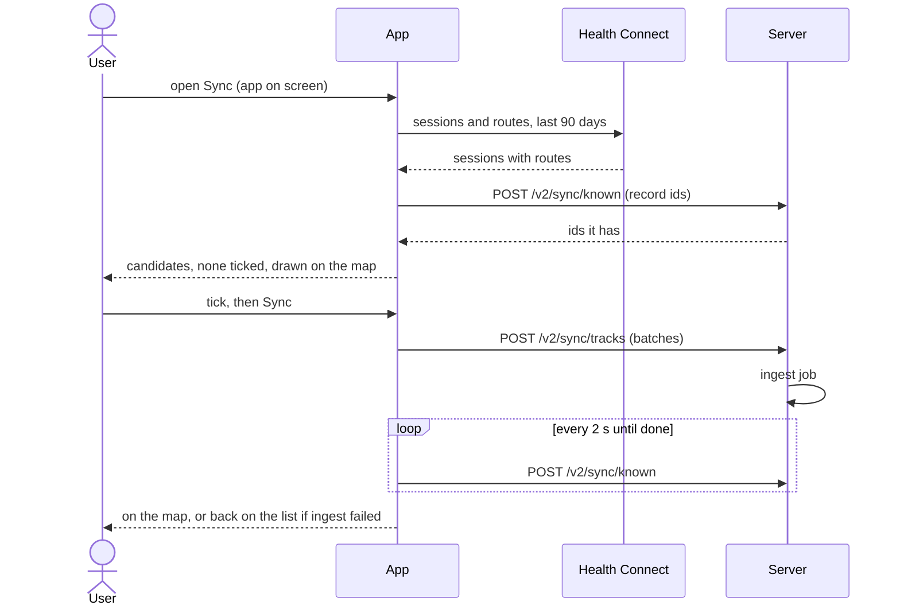

# HoldMyTrack for Android: Spec

| | |
| :-- | :-- |
| **Status** | Current: the app as built |
| **Last updated** | 2026-11-26 |
| **Related documents** | `apps/docs/SPEC.md` (what both apps do), `docs/SPEC.md` (the server and web behavior the apps share), `apps/android/docs/ARCHITECTURE.md` (the app's shape and stack), `apps/android/docs/IMPLEMENTATION.md` (how it's built), `apps/android/docs/ROADMAP.md` (open work) |

## 1. Introduction

### 1.1 Purpose

Where the Android app differs from what both apps do (`apps/docs/SPEC.md`), and what only it does: Health Connect sync. Its sections take that document's numbers; a requirement not named here is as written there.

### 1.4 Definitions

| Term | Meaning |
| :-- | :-- |
| **Session record** | A Health Connect exercise session: start and end time, an exercise type and sometimes a route. Not a sign-in session. |
| **Source** | Where candidates come from: Health Connect, switched on and off in Health Connect access, or Recorded on this phone, always on (FR-3.1). |
| **Readiness** | Where the user stands in Health Connect's permission sequence, one of six states (FR-3.1). |

## 3. FR-1 — Authentication & Session

### FR-1.1 Sign in, sign up, start a demo

- Google sends the system account picker's ID token with the phone's timezone.

### FR-1.4 Email verification

- Health Connect access, which Health Connect can open without the map, shows only a notice for such an account.

### FR-1.5 Settings

- Avatar: Android's photo picker, with no storage permission.
- Language, set on the You tab, sets the app's per-app language and the account's together; Automatic follows the phone. A sign-in or session check applies the account's language unless it's automatic. It does nothing for the demo account.

### FR-1.7 Privacy

- Download your data saves each archive to the phone's Downloads through Android's download manager.

### FR-1.8 Update screen

- Update opens the app's Play listing.
- Back closes the app, and it opens on the Update screen for as long as the server refuses the build.

## 4. FR-2 — Map Visualization

### FR-2.2 Two map modes: Normal and Fog of War

- The map never reads Health Connect.

### FR-2.7 Tracks panel

- Back drops the Private location editor's draft too.

### FR-2.8 Spots

- Back ends capture too.

### FR-2.9 The bottom bar

- Back from another tab goes to Tracks, from Sync to Library, and from Tracks leaves the app.
- Delete account also deletes the account's Health Connect switch and last read.

### FR-2.10 Photos

- Added photos come from Android's photo picker, which strips their location (§9).
- Back asks before throwing unsaved changes away, as Cancel does.

### FR-2.11 Map image export

- The image is saved to Pictures/HoldMyTrack and offered to Android's share sheet.

## 5. FR-3 — Sync and Imports

Health Connect's sessions are candidates beside the recordings (`apps/docs/SPEC.md` §1.4), each to tick before it goes.

### FR-3.1 Health Connect access — the switch and Health Connect's setup

- Health Connect's switch starts off, also on an install that granted its permissions before the switch existed, and is kept per account (FR-5.3). Off, Health Connect is read nowhere in the app.
- Turning it on with nothing granted opens Health Connect's dialog for sessions and history; once readable, it's read at once. Turning it off forgets the last read and leaves the grants alone.
- Only exercise sessions and their routes are asked for; no heart rate or other health permission is declared (ADR-0017).
- Readiness is worked out again on every resume:
  1. **Unavailable**: no Health Connect; the switch can't turn on.
  2. **Update required**: opens Health Connect to update.
  3. **Needs exercise permission**: asks for sessions and history.
  4. **Needs routes permission**: Android offers no request for it, so the app names the path in Health Connect's settings.
  5. **Needs history permission**: not blocking; the list reaches back 30 days instead of 90.
  6. **Ready**.
- Health Connect's rationale request opens the app's own rationale, with the privacy policy (`docs/SPEC.md` FR-9.5).
- Signed out, unverified or demo, the screen only says why nothing can sync.

### FR-3.2 What's waiting — the list

- Opening Sync shows what was last read and the recordings at once, then reads Health Connect when its last read is a minute old or more. **Refresh** reads it whatever the age; nothing else does, except the first read after switching it on. What a read finds is kept on the phone per account until the next one. A failed read keeps what was kept.
- Health Connect: sessions started in the last 90 days, read 100 at a time. A session is a candidate when its route is readable with at least 2 points. One with no route isn't listed and isn't an error. One whose route Health Connect withholds is counted with advice to keep the app on screen and check the routes permission.
- The record ids go to `POST /v2/sync/known`; what the account has, in any state, is left out, so a reinstall or second phone agrees and a deleted track is offered again. One still processing shows as on its way.
- No distance is read from Health Connect.
- **Foreground only**: a read runs only while its screen shows. Leaving the tab, the app going to the background or the You tab covering the map cancels it, since Health Connect withholds routes from a background read whatever was granted. Nothing schedules a read or a session's send.
- A read sends the server only the record ids.

### FR-3.4 Sending and its feedback

- Add sends the ticked sessions shown, and only them, in batches of at most 25 tracks or 20,000 points under `healthconnect`.
- Health Connect types map onto HoldMyTrack's (`biking` becomes `cycling`, `running_treadmill` becomes `running`), so the Type filter matches across sources.
- The route sent is the one Health Connect holds, read again by id, never the line drawn. A session gone from Health Connect, or whose route it withholds, is refused with the reason. Elevation goes only where a point has it. A route over 50,000 points is refused by the app.
- A sent session is unticked and, while being added, can't be ticked.
- Each refused row is listed with its reason and stays ticked. A run cut short leaves what wasn't confirmed ticked. Ticked rows that overlap don't stop a send.
- Leaving the tab or the app cancels a run safely: the server is idempotent on each track's id (`docs/SPEC.md` FR-3.4), and the next read knows what it took.

### FR-3.5 The Sync sheet — sending what's on the phone

- The demo account has nothing to tick and no read of Health Connect.
- A hidden session is forgotten only after a read that withheld nothing, so a route unreadable once keeps its place.
- Add, apart from Upload, sends the ticked sessions. When Health Connect was last read heads its sessions, with Refresh and the way to Health Connect access (FR-3.1).

### FR-3.6 Upload

- Files come from Android's picker; most apps can't open a `.gpx` or `.fit` with the app (§9).

## 6. FR-4 — Library

### FR-4.1 Library

- Download saves through Android's save screen, with no storage permission.

## 7. FR-5 — In-App GPS Recording

Recording is separate from Health Connect sync, so Health Connect's foreground rule doesn't apply.

### FR-5.1 Record — one button on the map

- Notifications are asked for but not required.
- Positions come from the GPS provider only.
- A foreground location service keeps recording with the screen off and the app swiped from recents.
- A notification shows while recording, with Pause or Resume and Stop. Its Stop asks first, since a tap in the shade is easy to make by mistake.

### FR-5.2 Recorded tracks — review, edit, send

- Download GPX saves with no storage permission.

### FR-5.3 Local storage is scoped per signed-in account

- The Health Connect switch and its last read are kept per account too.

## 8. Non-Functional Requirements (summary)

| Concern | Behavior |
| :-- | :-- |
| **Foreground-only Health Connect** | No background service or scheduled job reads Health Connect (FR-3.2). |
| **Safe interruption** | A cancelled read leaves what was kept; a cancelled run is known to the server at the next read (FR-3.2, FR-3.4). |
| **Idempotency** | Syncing a Health Connect record twice makes one track, keyed on its own id (`docs/SPEC.md` FR-3.4). |
| **Language** | English or Russian by the per-app language, else the phone's, else English; sent as `Accept-Language` (`docs/SPEC.md` FR-12.1). |
| **Accessibility** | Every control is labelled for TalkBack and at least 48 dp; at 1.3× font size and up, rows that no longer fit stack. |
| **Orientation** | Works in landscape with no control under the navigation bar or a cutout; the camera survives rotation (FR-2.3). |

## 9. Known Limitations & Out-of-Scope Items

- **An import in processing isn't shown.** Library lists tracks and Upload shows only queued and uploading files, so a file between the two is in neither.
- **A `.gpx` or `.fit` can't be opened with the app from most other apps**, which hand them over as generic binary; pick them on Upload. A `.tcx` can.
- **A picked photo's position rarely arrives**: Android's photo picker strips location, so photos are placed by capture time or by hand (FR-2.10).
- **Samsung Galaxy Watch is unsupported**: Samsung gives Health Connect no routes, so its sessions are never candidates.
- **Background Health Connect sync will never be built**: Health Connect withholds routes from background reads.