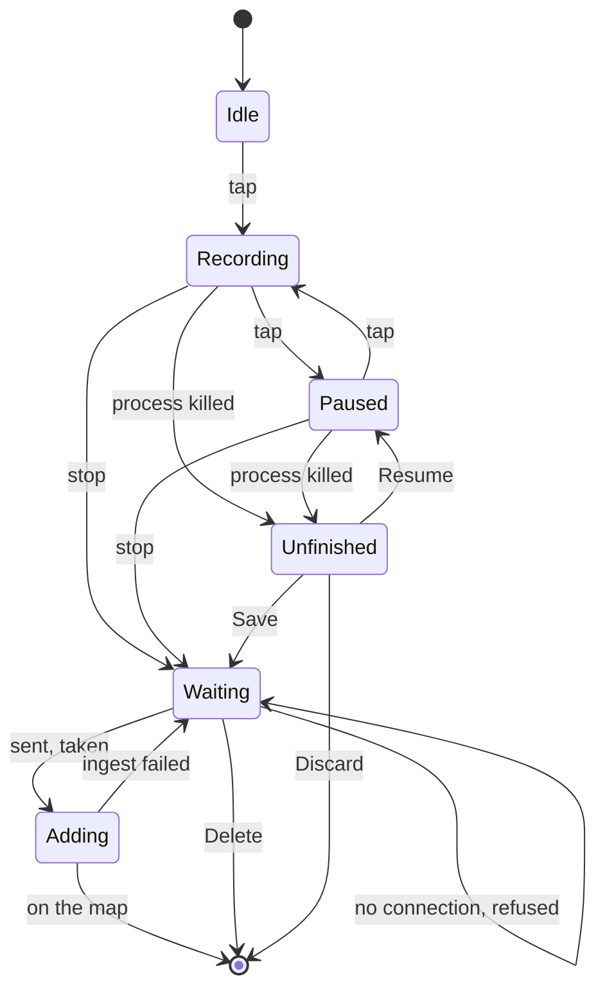

# HoldMyTrack apps: Spec

| | |
| :-- | :-- |
| **Status** | Current: the apps as built |
| **Last updated** | 2026-11-26 |
| **Related documents** | `docs/SPEC.md` (the server and web behavior the apps share), `apps/android/docs/SPEC.md` and `apps/ios/docs/SPEC.md` (where each app differs), each app's `ARCHITECTURE.md`, `IMPLEMENTATION.md` and `ROADMAP.md` |

## 1. Introduction

### 1.1 Purpose

What the Android and iOS apps both do, as a user can rely on it: where they differ from the web, and what only the apps do (GPS recording, Spot capture). What they share with the web is in `docs/SPEC.md`, cited by FR. Each app's `SPEC.md` holds only where that app differs and what only it has, under this document's section numbers. Screen wording and layout live in the code.

### 1.2 Scope

Every feature both apps have built; what they won't do is in §9.

### 1.4 Definitions

`docs/SPEC.md` §1.3's terms apply.

| Term | Meaning |
| :-- | :-- |
| **Candidate** | A recording on this phone, or on Android a Health Connect session with a readable route (`apps/android/docs/SPEC.md` FR-3.1), that the account doesn't have yet. "Waiting" means exactly this. |

## 2. Actors

| Actor | Can |
| :-- | :-- |
| **Anonymous visitor** | See the sign-in screen only: sign in, sign up or start a demo (FR-1.1). The map is never shown without a session. |
| **Demo user** | Read the Demo Customer account (`docs/SPEC.md` FR-2.1) and record on the phone; nothing reaches the server. |
| **Registered user** | Everything in this document, for their own account. |

## 3. FR-1 — Authentication & Session

### FR-1.1 Sign in, sign up, start a demo

One screen signs in, starts a demo or continues with a sign-in provider, against the web's endpoints (`docs/SPEC.md` FR-1.1, FR-1.2, FR-2.1, FR-1.9, FR-1.10), and opens sign-up.

- The app checks only that email and password aren't empty. Every other rule is the server's, and its message is shown as sent, so the two never disagree.
- The response's session token is kept with the email (empty for the demo account) and whether it's verified.
- Google and Facebook show only when `GET /v2/auth/providers` reports them configured; when that request fails, neither shows.
- Facebook runs the server's own flow in the browser, not Meta's SDK, started with the S256 hash of a random verifier the app keeps; the code returned to `holdmytrack://oauth` is redeemed with that verifier at `POST /v2/auth/handoff`.
- Creating an account opens the web's sign-up page in the browser, which passes the new account to the app as Facebook does and leaves the browser signed out (`docs/SPEC.md` FR-1.1).
- Forgot password opens the web's page (`docs/SPEC.md` FR-1.5) in the browser.
- Without a session this is the first screen. The map is never shown signed out: a base map without the account's layers demonstrates less than the demo does.

### FR-1.2 Session persistence and re-verification

A kept session survives a restart but isn't trusted until the server confirms it (`docs/SPEC.md` FR-1.4).

- On a cold start the map attaches no signed-in layer until `GET /v2/auth/me` answers. A `200` trusts the token for the rest of the process.
- Only a `401` clears the token and opens the sign-in screen. Any other failure keeps it, says the server couldn't be reached and retries on the next resume. The map never sits blank on refused tiles.

### FR-1.3 Sign out

`POST /v2/auth/logout` ends the session on the server; the phone forgets the token whether or not that request succeeded, and opens the sign-in screen with every other screen cleared. The next account to sign in sees nothing of the last one's: its captures, photos, open Trip and queued files go with the session.

### FR-1.4 Email verification

An unverified account (`docs/SPEC.md` FR-1.8) sees a "check your email" screen instead of the map, whose tiles the server would refuse.

- The email's 6-digit code, typed on the screen, verifies the account and opens the map with the app still signed in. The server's refusal of a code is shown as sent.
- The screen asks `GET /v2/auth/me` again on every resume, and on Confirm with the field empty, and opens the map once the email is verified. A `401` signs out as in FR-1.2.
- Resend shows the server's answer as sent, its hourly limit included.
- Changing the address is web-only: the phone keeps recordings and Sync state by email (FR-5.3), which a change would orphan. A demo account is never gated.

### FR-1.5 Settings

The web's Settings page (`docs/SPEC.md` FR-1.7) shown in the app (`docs/SPEC.md` FR-9.6), in the app's theme and language.

- Theme, Download your data and Delete account are native instead (FR-2.9, FR-1.7).
- Avatar: picked from the phone's photos, shrunk to at most 512 px on the long side, uploaded as JPEG at once. An image the phone can't read leaves the avatar as it was.
- Country sets the app's units, metric until one is saved; a change applies at the next session check, made whenever the You tab or the map shows.
- First run: a real, verified account with no Country opens on Settings instead of the map, and only saving gets past it. A new email-and-password account starts on the phone's timezone.
- The demo account's page is read-only. A link to another page opens in the browser.

### FR-1.6 Track graph & trends

The web's `/profile` page, the track graph and Trends (`docs/SPEC.md` FR-6, FR-8), shown in the app (`docs/SPEC.md` FR-9.6) and read again each time the screen comes back to the front.

### FR-1.7 Privacy

- Private locations (`docs/SPEC.md` FR-7.1) are read again each time the screen shows; a row or Add opens FR-2.7's editor on the map.
- Download your data (`docs/SPEC.md` FR-1.13), for a real account only: a native screen that checks the request every 10 seconds while it shows and hands each archive to the phone.
- Privacy policy opens `/privacy` in the browser.
- The demo account sees its Private locations read-only and no download.

### FR-1.8 Update screen

When any `/v2` request answers `426` `app_outdated` (`docs/SPEC.md` §1.4), signed in or not, the Update screen opens over whatever showed.

- Several refusals at once open it once; a refused request's own screen says nothing.
- A refusal met while the app is in the background opens it when the app next comes to the front.
- Update opens the app's store listing.
- Nothing on the phone changes: what waits on the Sync tab stays to be sent from the updated app, and a recording under way carries on.

## 4. FR-2 — Map Visualization

### FR-2.1 Base map

- The style comes unauthenticated from `GET /v2/map/style/{flavor}?lang=`: `light` or `dark` by the app's theme (the other flavors aren't offered), labels in the app's language (`docs/SPEC.md` FR-12.1).
- The camera starts on a world view until FR-2.3 frames the account.
- The map is flat at every zoom: MapLibre Native has no globe (`docs/SPEC.md` FR-4.4).

### FR-2.2 Two map modes: Normal and Fog of War

The web's two exclusive modes (`docs/SPEC.md` FR-4.1–FR-4.3), from the same tiles, with Fog's coverage drawn under the routes and the labels.

- Normal's routes follow Dates (FR-2.6) through the tile request, and past the list's cap only the listed ones are drawn (`docs/SPEC.md` FR-5.11). The panel's filters, hidden tracks and Pending rows are applied on the phone. Fog is never filtered.
- The map reads only the server: a track appears only once sent and ingested.
- The mode survives a theme or language change.
- The mode toggle is the Tracks tab's. Trips and Sync show the map in Normal, since their sheets and routes are Normal mode's, and back on Tracks the mode picked there returns. Unlike the web, whose panel stays beside Fog (`docs/SPEC.md` FR-13.6).
- While recording (FR-5.1) the mode toggle goes and no mode's layers are drawn, only the recording; the mode comes back when it stops.
- The Layers menu (`docs/SPEC.md` FR-4.9) holds Show layers, Satellite only when the style carries imagery (`docs/SPEC.md` FR-4.10), Roads (`docs/SPEC.md` FR-4.13) and the bike, shared and mountain-bike paths; the Places menu holds Show places and the Spot categories (FR-2.8). Each switch hides its own picks and keeps them. Every choice is kept on the phone, not the account, and all picks but Roads start off. Both menus stay while recording.
- Fog says when coverage is still being updated (`docs/SPEC.md` FR-4.2), checked on every opening of the map, and refresh when the server is done.
- Fog's button names the level in view, and a tap on it while Fog is on opens the level menu (`docs/SPEC.md` FR-4.2), its counts read on each opening. A picked level holds through a trip out of Fog and until the app restarts. A tap on a place outlines it and names it, as the web's tooltip does, until it's closed or a tap lands off every place.

### FR-2.3 Initial camera framing

- Once per app session the camera opens as the web's does (`docs/SPEC.md` FR-4.4): zoom 12 on the newest five tracks with a route, skipping Pending ones, or fewer when five don't fit the screen. A rotation, theme or language change keeps the camera.
- An account with nothing on the map stays on the world view with a pointer to Sync, asked again on every return to the map until it is closed, which this phone remembers for the account; the demo account never gets it.

### FR-2.4 Attribution

MapLibre's attribution control stays on and visible above the collapsed sheet: the base map's ODbL credit is required (`docs/IMPLEMENTATION.md` §5.6).

### FR-2.5 Find my location

The web's one-shot locate (`docs/SPEC.md` FR-4.5).

- Nothing is located before the first tap, which asks for location, Precise or Approximate.
- It flies to at least zoom 14 and follows the position until the map is panned.
- Hidden while recording, which follows its own fixes.

### FR-2.6 Dates

The Tracks tab lists the visible area under Dates, as the web's does (`docs/SPEC.md` FR-5.11, FR-5.12), in Normal mode only.

- Dates is a chip in the filter row. Each end is picked in a calendar and applies at once; Clear dates clears both.
- The list doesn't follow the camera while recording, and asks about the view once it stops.
- Dates survive rotation and a return from another tab.

### FR-2.7 Tracks panel

The web's Tracks panel (`docs/SPEC.md` FR-5) as a sheet over the map, with Tracks and Trips tabs. Normal mode only, not while recording. Every tab's sheet, Sync's too, opens up to the status bar, over the map's top row.

- Rows, badges, the Type and Distance filters and Pending follow `docs/SPEC.md` FR-5.1–FR-5.3 and FR-5.8. The Distance filter is offered only with two or more distinct distances.
- A tap on a row, or on a route within 14 points of the screen, focuses that track and fits the camera to it; one at a time.
- A tap on a row's tile or a long press checks it. Unlike the web, focusing unchecks the rest, the first check takes the focused track into the group, and checking a row flies the camera to it; unchecking doesn't. All, None and Invert reach only the listed rows and never move the camera.
- The toolbar acts on the checked group, else the focused row (`docs/SPEC.md` FR-5.8). Hide lasts for this app session. Delete is disabled while any target is Pending.
- The list is read for each range and on every return to the map, keeping what of the focus, checked group and hidden set still exists; every 2 seconds while any row is Pending, including one the list no longer shows.
- Edit (`docs/SPEC.md` FR-5.5) writes only what changed, one track at a time. A group of mixed types starts with Type empty, and leaving it empty keeps each its own.
- Delete (`docs/SPEC.md` FR-5.6) asks first; on a failure, what was already deleted is reported as gone.
- Download (`docs/SPEC.md` FR-17.2) acts on the checked tracks. Past 100 tracks, or with a Pending track or one entirely inside Private locations among them, it says why instead. It saves as Library's does (FR-4.1).
- The focused track is drawn in pace bands (`docs/SPEC.md` FR-4.6), unless hidden, filtered out or Pending.
- Route editing (`docs/SPEC.md` FR-5.7, FR-5.9), for one track with a finished route, has Chop, Cut, Split, Move point, Delete point, Undo and Reset. A split leaving a part inside a Private location asks first.
- The Private location editor (`docs/SPEC.md` FR-7.1) switches the map to Normal and draws every circle. A new one is 200 m at the map's centre; the radius moves in 10 m steps. Cancel, a mode change or a recording starting drops the draft.
- The Trips tab (`docs/SPEC.md` FR-13.6) opens the newest Trip. Taking a track out needs no confirmation; deleting a Trip asks first. Leaving the tab restores the Tracks range. Copies others sent wait at its top to be accepted or declined (`docs/SPEC.md` FR-13.7, FR-13.8).
- Add to trip (`docs/SPEC.md` FR-13.2, FR-13.3) adds the toolbar's target to a Trip, or a new one, in one request.
- The demo account can't edit, delete or change a Trip.

### FR-2.8 Spots

The web's points of interest (`docs/SPEC.md` FR-14.2–FR-14.4) on the same tiles, and, in the apps only, capturing a place by going there (`docs/SPEC.md` FR-14.6).

- One Places entry per category, off until ticked, kept on the phone; drawn in every mode and while recording, hidden while a route is edited.
- From zoom 13 ticked places show with their areas; from 10 to 13 on request. A captured place's badge is filled, and a retired place shows only to an account that captured it.
- A place's popup offers Capture, except on a captured place or to the demo account.
- **Capture rule**: 30 seconds inside the place, counting only fixes accurate to 25 m. A fix outside starts the count again. In the background nothing is read and the count waits.
- Capture asks for precise location first; without it nothing starts. Location is read only while capture runs and only in the foreground, and the screen stays on meanwhile.
- The server checks the position (`docs/SPEC.md` FR-14.6): refused, the count starts again; unsent, it's retried every 5 seconds. A place retired since the map loaded it ends capture.
- Capture ends on success, Stop, a route edit starting, unticking the category or leaving the account.

### FR-2.9 The bottom bar

Tracks, Trips, the record button (FR-5.1), Library (FR-4.1) and You.

- Each tab keeps its state: the map's camera, mode, range, focus, checked group and a recording are as they were on coming back.
- Trips counts copies waiting to be answered, and Library the recordings waiting to be sent. Starting a recording from another tab moves to the map.
- The You tab leads to Settings (FR-1.5), Track graph & trends (FR-1.6) and Privacy (FR-1.7), and shows the app's version and commit.
- Theme belongs to the phone, not the account (`docs/SPEC.md` FR-4.8), so the demo account can change it.
- About opens in the app (`docs/SPEC.md` FR-9.6); Help and Contacts in the browser, in the browser's language. The apps have no Donate: neither store allows pointing to payment outside its own.
- Delete account (`docs/SPEC.md` FR-1.12), for a real account, is confirmed by typing the email. On success the app also deletes that account's unsynced recordings, one under way or interrupted before Stop, its last recording type and hidden Sync rows, since a new account could take the same email, then signs out.

### FR-2.10 Photos

The web's photos (`docs/SPEC.md` FR-15, ADR-0024) on the map and in the Edit window's Photos tab, against the same endpoints.

- The map shows, in Normal mode, the photos of the track being edited, else the focused one, else the open Trip's. None in Fog, on a hidden route, on the Route tab or while recording. Smaller below zoom 10, none below 4 (`docs/SPEC.md` FR-4.11).
- Photos that would overlap share a marker; a tap zooms in to separate them (up to zoom 19) when they lie more than 15 m apart, else steps through them.
- The Photos tab is for one track with a route. Added photos come from the phone's photo picker, are redrawn upright at most 2,048 px with a 320 px thumbnail and placed by the server's placement check. One it can't place waits for the user to place it on the route, and Save is refused while any waits.
- Nothing is written until Save, which writes the fields, then uploads, changes and deletes one at a time, then a route edit. A failure keeps the window open, and Save again carries on from the first unwritten change. Cancel asks before throwing unsaved changes away.
- The demo account has no Edit window, so no Photos tab.

### FR-2.11 Map image export

The web's export (`docs/SPEC.md` FR-4.7) as a viewfinder over the map, not offered while recording.

- A platform preset keeps its shape when cropped; Custom fixes the long side at 1,920, 2,560 or 3,840 px.
- The image is exactly the window at the current zoom and rotation, with what `docs/SPEC.md` FR-4.7 draws, paths, Satellite and Roads included, and the map's credit and the HoldMyTrack mark.
- Its stats card (`docs/SPEC.md` FR-4.7) can be added while tracks are checked, and the choice is kept by the phone.
- A failure keeps the viewfinder as it was.

### FR-2.12 Tour

The web's tour (`docs/SPEC.md` FR-4.14) over the app's own screens, with its start, offer and card rules (`testdata/client-rules/tour-*.json`).

- Its steps: the Tracks sheet, Dates, Trips, Layers, Places, export, Fog of War, Record (FR-5.1), Sync (FR-3.5), and Take a tour on the You tab, which starts it again. Fog's last step opens its level menu. Each step opens the tab, sheet or menu it explains; the user's tab, mode and sheet come back when it ends.
- In a demo session Fog takes a step per level, from exact coverage out to countries, with the camera over the demo's history, and the camera comes back when the tour ends.
- What has been shown is kept by the phone, not the account.

## 5. FR-3 — Sync and Imports

Sync needs a verified session; the demo account can't send. **The gate rule** (ADR-0039, `docs/SPEC.md` FR-3.4): nothing is ticked when a list shows, only what the user chose is sent (a ticked session, a picked file, a saved recording), and nothing is hidden, merged or changed on the user's behalf.

### FR-3.2 What's waiting — the list

The Sync sheet lists every candidate and draws it on the map.

- Every recording on the phone not sent yet is listed, whatever its age, never ticked (FR-5.2).
- A row's distance is worked out from its route.
- A row overlapping another candidate or an account track (`docs/SPEC.md` FR-3.5) is marked, as a hint only. Hidden and on-their-way rows aren't compared.
- The map draws the candidates from the phone's data, and none of the account's routes.
- Showing the list sends the server only the spans for the overlap check.

### FR-3.4 Sending and its feedback

- What the server took or already had stays listed as being added until its ingest ends; the app asks every 2 seconds on any tab. Landed, it leaves the list and the map refreshes; failed on the server's side, it's back on the list to send again.
- An alert lists the imports that failed on the server's side, files and synced tracks alike, each with the server's reason; closing it dismisses them. It's checked whenever the map comes to the front and when a sent row fails.

### FR-3.5 The Sync sheet — sending what's on the phone

Library › Sync is the map in Normal mode with the sheet on its Sync tab, also while recording, with Library lit in the bar.

- Leaving it takes its lines off the map.
- The demo account sees its recordings, to edit and delete, with no upload.
- Swiping a row hides it from the list, kept on the phone per account and undoable. A hidden row is forgotten once its candidate is gone.
- Upload (FR-3.6) heads the sheet; the recordings not sent yet have Retry. Upload is gone for the demo account.

### FR-3.6 Upload

The web's upload (`docs/SPEC.md` FR-3.1, FR-3.2) as a sheet over the screen it opens from, for a verified, non-demo account.

- Files come from the phone's file picker, or are opened or shared from another app. Files from another app are listed and sent only on Upload.
- The web's limits apply: `.gpx`, `.fit` or `.tcx`, up to 16 MiB each, 20 at a time (more are refused whole) and 100 an hour; a `.zip` is refused by name.
- Files go one at a time and carry on when the sheet is closed. Finished ones are tracks in Library, and the map and Library catch up as each finishes processing, whichever tab shows.
- Files still queued at a sign-out are dropped, never sent from another account.

## 6. FR-4 — Library

### FR-4.1 Library

The web's Library (`docs/SPEC.md` FR-17.1) as the bottom bar's Library: a sheet over the map, as Tracks and Trips are, its page read again each time the tab opens. Sync (FR-3.5) opens from Library, with the recordings waiting.

- The search, the sort and the Type, Dates, Distance and Trip filters, pages of 100, Checked within the page, Download and Delete are the web's (`testdata/client-rules/library-*.json`).
- Opening a track opens it on the Tracks tab with the track focused. When its day is outside the range, the range becomes that day, as if picked.
- Download gives one track as GPX and Checked tracks as a zip.
- The map under Library and Sync draws every track that isn't Hidden or Pending: the Tracks tab's Type, Distance and Dates (`docs/SPEC.md` FR-5.2, FR-5.3, FR-5.12) apply on that tab only and stay set for it. Library's own filters narrow its list, not the map.

## 7. FR-5 — In-App GPS Recording

A finished recording goes straight to `POST /v2/sync/tracks` under `recorded` (`docs/SPEC.md` FR-3.6). A recording not discarded is sent without a tick: recording it was the choice (ADR-0039).

Waiting: saved on the phone, listed on the Sync tab until sent. Adding: taken by the server, gone from the phone once on the map. A stop under 60 seconds of moving time, or with fewer than 2 points, saves nothing.

### FR-5.1 Record — one button on the map

The record button, on every tab, records a casual GPS track in one tap and asks nothing about it.

- Recording needs precise location; denied, nothing starts.
- Only positions are read; no sensor or health data.
- Recording goes on with the screen off and the app in the background.
- A tap pauses and resumes. No point is recorded while paused, and the first fix after a pause starts afresh, so a stop adds no distance. There is no automatic pause.
- Holding the button 2 seconds stops; letting go sooner stops nothing.
- While recording the map shows only the recording. An unsynced recording is never drawn after it stops.
- Stop saves the recording on the phone with no name and the type last set in Edit on this account (`unknown` at first), then opens it for naming; Discard asks and deletes it. Leaving it any other way sends it (FR-5.2).
- **Crash recovery**: every fix is written to disk as it arrives. If the process dies while recording or paused, everything up to the last fix is kept, and the next time the map opens under that account it asks to Resume (paused, the gap adding no time or distance), Save (as Stop) or Discard. Nothing restarts on its own. Without location access, Resume is refused until the next prompt. A leftover from another account waits for that account; starting a new recording first saves it under its own account.

### FR-5.2 Recorded tracks — review, edit, send

A saved recording is sent on its own under `recorded`: on Save, then whenever the map comes to the front, until the server takes it. Until then it is listed on the Sync tab (FR-3.2), never ticked, as sending, not sent yet, or refused with the server's reason.

- They never age out of the list: the phone holds the only copy.
- A recording swiped aside on the Sync tab isn't sent, nor counted as waiting, until it's brought back.
- A recording the server can't take doesn't hold up the others.
- Any type syncs, `unknown` included; the overlap hint compares time, not type.
- Edit sets name, description and type. The type picker lists the account's types, most used first, server's and phone's together, then the common ones not yet used; a new type is kept as typed, up to 50 characters. The type set becomes the account's default for the next recording.
- Download GPX gives the route as GPX 1.1.
- A recording the server takes leaves the list but stays on the phone until it is on the map; if its ingest fails it is listed again, even after a restart.
- A refused one, or one whose ingest failed, is sent again only on Retry, so the same refusal isn't asked for on every return.
- Delete asks first, since the copy is the only one.
- The demo account can record, edit and delete, not send.

### FR-5.3 Local storage is scoped per signed-in account

Recordings belong to the account signed in when they began (the demo account has a key of its own). Hidden Sync rows are kept the same way. One account never sees, or sends, another's recordings on a shared phone.

Nothing the app keeps on the phone goes into a backup or moves to a new phone: unsent recordings are sent from the phone they were made on, and the new phone signs in again.

## 8. Non-Functional Requirements (summary)

| Concern | Behavior |
| :-- | :-- |
| **Credentials** | The session token goes as `Authorization: Bearer` to HoldMyTrack's own API origin only, never to a base-map asset origin (FR-1.2). |
| **Session security** | A kept token is confirmed before any signed-in layer; sign-out ends the session on the server (FR-1.2, FR-1.3). |
| **Nothing sent unasked** | Only what the user chose reaches the server; nothing is ticked when a list shows (FR-3). |
| **Idempotency** | Sending a recording twice makes one track, keyed on its own id (`docs/SPEC.md` FR-3.4). |
| **Version gate** | Every request names the build in its User-Agent, so the server can turn away an old one (`docs/SPEC.md` §1.4). |

## 9. Known Limitations & Out-of-Scope Items

- **A touch and hold stands in for hover** where the web reads a value on hover.