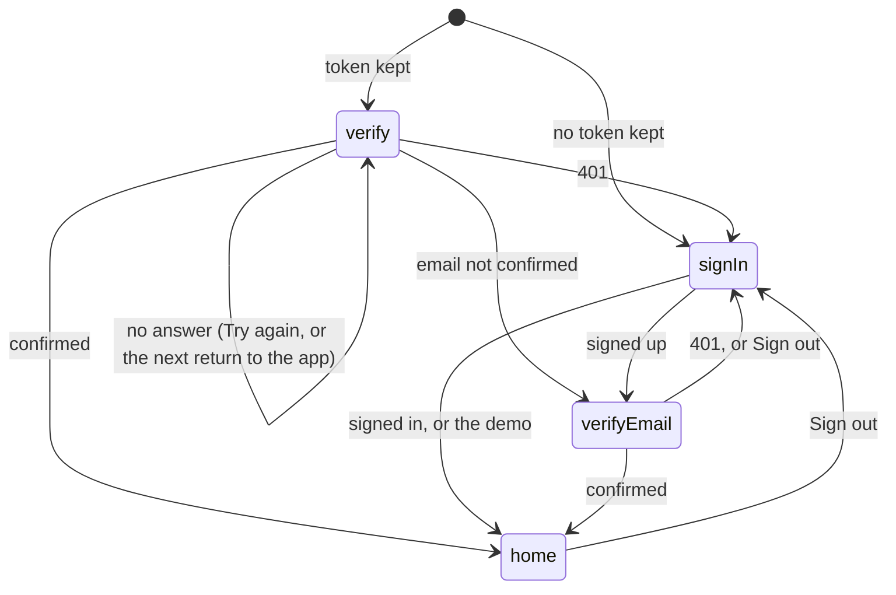

# HoldMyTrack for iOS: Implementation

> **Scope note.** How the iOS app is built where the code can't say it: flows across files, invariants, reasons for a design that isn't the obvious one, and traps. The app's shape and stack are `ARCHITECTURE.md`, its behavior `SPEC.md`, and the server side of every call root `docs/IMPLEMENTATION.md`. Its sections take the Android document's numbers; detail confined to one type is in that type's doc comment.

## 2. Session and auth

### 2.1 One credential

**`APIClient.authorize` is the one place a request gets the token and the app's headers**: the bearer token, the User-Agent the minimum-build check reads and `Accept-Language`, and only for a URL `ApiOrigin.isAPI` places on the API's own origin, compared parsed since a string prefix also matches `holdmytrack.com.evil.tld`. MapLibre's tile requests are to go through it too (`ROADMAP.md`, 7a.1). A `426` from any call runs `onOutdated` before the call throws, and `AppFlow` puts the Update screen over every screen from then on, so no screen checks for it.

### 2.2 The wire

**Every body is a type in `HoldMyTrackCore`'s `Wire.swift`, held to `services/server/api` by `WireContractTests`**, with the fields of Android's `net/Wire.kt`. Swift has no runtime view of a type's fields, so the test runs each type's own `init(from:)` against a decoder that answers from the contract's schema: `decode` asks for a field the type needs, `decodeIfPresent` for one it can do without, and a request type is read the same way, since its synthesized `Encodable` sends what its `Decodable` reads. A field the server renames, drops, retypes or sends as null fails `swift test`. Keys are spelled out in `CodingKeys` rather than left to a key strategy, so the name the test sees is the one on the wire. Unknown keys are skipped, so a field the server adds breaks no installed version. Yams, which reads the YAML, is a dependency of the test target alone.

### 2.3 Sign-in and the session

`SessionRoute.of` is the diagram's rule, over the kept session and the account the server confirmed this run; `AppFlow` sets the window's screen from it. Onboarding goes to the signed-in screen until the site's pages exist (`ROADMAP.md`, 6.2).

- **The Keychain outlives an uninstall**, so `SessionStore` deletes its item on the first launch of an install, which a UserDefaults marker tells apart; an uninstall removes the marker. The item is this device's only and readable after the first unlock, so a background upload still has the token.
- **Sign-out sends the token it ends explicitly** (`APIClient.logout(token:)`): the phone forgets it at once, before the request is built.
- **A check only replaces the screen when the route changes** (`AppFlow.recheck`), so Verify email's Continue keeps its place to say the address isn't confirmed yet.
- **Sign in with Apple's entitlement is set only by `Config/Signing.xcconfig`**, since it needs a team's provisioning profile and CI builds with none. A build without it still shows the button when the server offers Apple, and its sheet fails.
- **Google and Facebook use ASWebAuthenticationSession**, whose completion hands the callback URL to the session that started it, so no other app's `holdmytrack://` link reaches it; `OAuthRedirect` still decides what the URL means, and the verifier lives only as long as that session. A Debug build's `-hmtSignedOut` launch argument deletes the kept session, for the UI tests.

## 3. Map overlays

### 3.3 Logic ported from the web

**Each rule in `testdata/client-rules/` is a pure function or value type in `HoldMyTrackCore`'s `Rules/`**, run against every case by `ClientRulesTests`, which fails on a rule file with no Swift implementation (ADR-0049). The numeric rules are ported from the web's TypeScript rather than Android's Kotlin, since the generated cases are the web's answers: Swift's `Double` matches JavaScript's numbers where Android uses `Float`, and a halfway value rounds up, as `Math.round` does, not away from zero, as Swift's `rounded()` does. The selection and the map session are structs whose `mutating` methods are the rules, where Android's are classes.

## 6. Build traps

- **The API origin is a build setting, `HMT_API_BASE_URL`**, read from Info.plist. An xcconfig file reads `//` as a comment, so the origins are written `http:$(SLASH)$(SLASH)…`. Release sets its origin after every include and never reads `Local.xcconfig`, so no developer's override reaches the App Store build.
- **Info.plist can't differ by configuration without a preprocessor**, which would also cut every URL at its `//`. So `scripts/stamp-build.sh`, the app's last build phase, edits the built plist: the commit count as the build number (`ARCHITECTURE.md` §1, D9), outside a checkout 1 in Debug and a failed build in Release, which a shallow clone fails too; the short commit; and, in Debug only, `NSAllowsLocalNetworking`, the one App Transport Security key it touches. It needs git and the build directory, so the app target turns off script sandboxing.
- **Info.plist lives in `Config/`**, outside the folder-synchronized `HoldMyTrack/` folder: every file in that folder joins the app target, and the plist would be copied in as a resource.
- **The palette, scales, fonts, icons and licenses are written, not edited**: `scripts/make-design.py` makes them from the web's `tokens.css` and the Android app's resources, and CI runs it with `--check`. Colors and icons are used through the asset catalog's generated symbols, `UIColor(resource: .accent)`, so a missing one fails the build.
- **A command-line build doesn't add a new string to the String Catalog**, as Xcode's editor does, and nothing fails on a missing translation. So `scripts/check-strings.py`, run after the sources compile, reads the strings the compiler found (`*.stringsdata`) and fails on one the catalog lacks, one without its Russian, or a Russian whose placeholders differ.
- **What decides over plain values lives in `HoldMyTrackCore`**, a local Swift package the app links, and its tests run with `swift test` on the Mac: the app's own test target needs the simulator booted and the app built, minutes on CI where the package takes seconds. A type moves there once it needs no UIKit; what reads `Bundle.main` stays in the app as an extension, so the package's tests pass every value in.
- **CI's Xcode can trail this Mac's by a release**, and its simulators' names change with each runner image, so CI picks the newest iPhone the runner has.