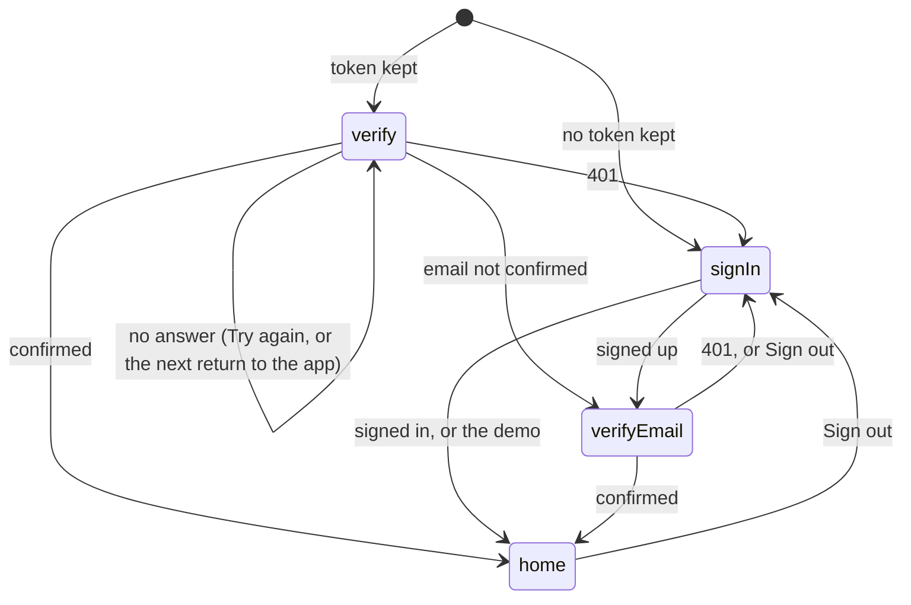

# HoldMyTrack for iOS: Implementation

> **Scope note.** How the iOS app is built where the code can't say it: flows across files, invariants, reasons for a design that isn't the obvious one, and traps. The app's shape and stack are `ARCHITECTURE.md`, its behavior `SPEC.md`, and the server side of every call root `docs/IMPLEMENTATION.md`. Its sections take the Android document's numbers; detail confined to one type is in that type's doc comment.

## 1. App shell and navigation

### 1.4 The web's pages in a web view

Settings, Track graph & trends, Sync history and About are the server's pages in `WebPageViewController` (ADR-0042); how the server renders a page for the app is root `docs/IMPLEMENTATION.md` §4.19.

- **Signed in by cookie, in a store of its own.** A `WKWebView`'s requests never pass through `APIClient`, so the session, the `hmt_app` marker and the app's language (`WebPageSession.cookies`) go into the page's cookie store before its first load. Each page gets a non-persistent `WKWebsiteDataStore`, gone with the page, so sign-out has nothing to clear and no cookie reaches another account.
- **`route` acts on where a navigation goes**, decided by the shared `webPageRoute` rule (`WebPageSession.route` reads a URL into its parts, the port in the authority). It runs in `decidePolicyFor`, told whether the navigation is a POST, and again on a server redirect. A form the server refuses, answering with the page at the form's path, stays in the page; first-run Settings' save, redirecting to `/`, reaches `AppFlow.check` and so the map.
- **Closing a page reads the account again** (`AppFlow.refreshAccount`), since Settings can change the units, name or Country; the map and the You tab hear `AppFlow.accountChanged`. The app's language is iOS's per-app setting (`ARCHITECTURE.md` §1, D11), which the page doesn't change.
- **View on map** is a link to `/` with the track's id and day: the tab bar moves to Tracks and `MapViewController.viewOnMap` focuses the track once the next list holds it, applying its day as the range first when it's outside it.

## 2. Session and auth

### 2.1 One credential

**`APIClient.authorize` is the one place a request gets the token and the app's headers**: the bearer token, the User-Agent the minimum-build check reads and `Accept-Language`, and only for a URL `ApiOrigin.isAPI` places on the API's own origin, compared parsed since a string prefix also matches `holdmytrack.com.evil.tld`. MapLibre's tile requests and the uploads go through it too. It turns off cookie handling on each such request: the server reads its session cookie before the bearer token, and URLSession keeps the cookie every sign-in answers with, so a cookie left from another account, or one not yet written to disk when the app died, would override the kept token and sign the user out at the next launch. `AppFlow` deletes any such cookie still on disk at launch. A `426` from any call runs `onOutdated` before the call throws, and `AppFlow` puts the Update screen over every screen from then on, so no screen checks for it.

### 2.2 The wire

**Every body is a type in `HoldMyTrackCore`'s `Wire.swift`, held to `services/server/api` by `WireContractTests`**, with the fields of Android's `net/Wire.kt`. Swift has no runtime view of a type's fields, so the test runs each type's own `init(from:)` against a decoder that answers from the contract's schema: `decode` asks for a field the type needs, `decodeIfPresent` for one it can do without, and a request type is read the same way, since its synthesized `Encodable` sends what its `Decodable` reads. A field the server renames, drops, retypes or sends as null fails `swift test`. Keys are spelled out in `CodingKeys` rather than left to a key strategy, so the name the test sees is the one on the wire. Unknown keys are skipped, so a field the server adds breaks no installed version. Yams, which reads the YAML, is a dependency of the test target alone.

### 2.3 Sign-in and the session

`SessionRoute.of` is the diagram's rule, over the kept session and the account the server confirmed this run; `AppFlow` sets the window's screen from it. Onboarding is Settings as the window's root, with no tab bar behind it.

- **The Keychain outlives an uninstall**, so `SessionStore` deletes its item on the first launch of an install, which a UserDefaults marker tells apart; an uninstall removes the marker. The item is this device's only and readable after the first unlock, so a background upload still has the token.
- **Sign-out sends the token it ends explicitly** (`APIClient.logout(token:)`): the phone forgets it at once, before the request is built.
- **A check only replaces the screen when the route changes** (`AppFlow.recheck`), so Verify email's Continue keeps its place to say the address isn't confirmed yet.
- **Sign in with Apple's entitlement is set only by `Config/Signing.xcconfig`**, since it needs a team's provisioning profile and CI builds with none. A build without it still shows the button when the server offers Apple, and its sheet fails.
- **Google and Facebook use ASWebAuthenticationSession**, whose completion hands the callback URL to the session that started it, so no other app's `holdmytrack://` link reaches it; `OAuthRedirect` still decides what the URL means, and the verifier lives only as long as that session. A Debug build's `-hmtSignedOut` launch argument deletes the kept session, for the UI tests.

## 3. Map overlays

### 3.1 Layers and the style

**The map loads one style that `MapStyle.compose` makes from the two documents** (root `docs/ARCHITECTURE.md` §2.1): the layers document's sources on the API's origin, its layers placed by the shared `layer-insertion` rule in the steps Android adds them in, the mode's view, the Layers menu's switches, Satellite and Roads from the style's metadata, and each `["var", …]` bound with `let`. MapLibre Native iOS can't add a layer from JSON, as Android can't, but it loads a whole style from it, so the combining is plain JSON in `HoldMyTrackCore` and tested there; Android instead builds each layer by type.

**A state change is patched when it can be**: `MapStyle.changes` compares the new style with the loaded one, and `MapPatcher` sets each changed property, visibility, filter and zoom range (Fog's locked level) on its layer, by the style spec's name camelCased (with MapLibre iOS's renames). A GeoJSON source's new data (`MapState.geojson`: the focused track's pace bands) is set on its `MLNShapeSource`; any other changed source, such as a new tile version or the routes' Dates, or a property it can't set, reloads the style, which keeps the camera. A color given as a string is set as a `UIColor` (`CSSColor`): MapLibre iOS's color setters throw on a string, and its expression parser has no `to-color`; Satellite's view is the first to patch one.

- **The documents are kept in Caches with their ETags** (`MapDocuments`): a later launch draws the kept pair at once and revalidates; the layers document per account, since it carries the account's tile version. Two documents from different builds fetch the style again.
- **Spots' badge images are drawn by the app** (`addBadgeImages`): the layers document names each image and its colors (`holdmytrack:images`), and a style load drops them, so they're drawn again on every one. What the group shows follows its switch and vars (`Spots.apply`); "Show in this area"'s places are a GeoJSON source's data, as the pace bands are.
- **The list follows the map, never the app's own flights** (`MapViewController+Area`): a camera move the app makes (`fit`, the opening view) sets `appFlying` until it completes, and `cameraSettled` skips it, or focusing a row would shrink the list to that row's route. So `fit` is one camera move with one completion: a box that would zoom past the limit is widened about its centre instead of zoomed back after. Dates reach the routes as their source's query, so new Dates reload the style; past the cap the tracks layer's `capped` and `listed` vars draw only the listed ones.
- **The area's rows are slim** (`GET /v2/tracks/area`): the Edit window reads each track in full (`GET /v2/tracks/{id}`) before it opens, for the description, the route's edit and the photos.
- **The basemap's and the imagery's reachability are timed from their own sources' tiles** (`tileDidTriggerAction`, `protomaps` and `satellite`), as on Android: failing imagery keeps the map from ever finishing rendering, so `fullyRendered` would call the basemap unreachable.
- **Capture's guide line is the app's own layer** (`addGuide`), added on every style load outside `MapStyle`'s JSON, so neither a patch nor `MapStyle.changes` sees it; the darker areas are the spots group's `captureTarget` var. `CaptureController` reads its own `CLLocationManager`, stopped while the app is in the background, and counts by each fix's own timestamp (`SpotCapture`).
- **The Layers, Places and Fog level menus are panels in the map's view** (`MapMenuPopup`), since a `UIMenu` holds no switch, swatch, key or count, and the app can't open one for the tour. The tour holds a menu after the step's tab and mode change, since a tab switch moves the map between hosts and Fog's menu hangs from Fog's button; leaving the map closes only a menu the user opened.
- **Find my location follows only once a position has arrived**: MapLibre sets its own zoom when following starts, so the zoom to 14 comes after it, and following before the first position lost the zoom altogether. iOS calls the authorization callback at every launch, so only a tap's prompt follows.
- **The opening view runs once per app session per account** (`OpeningView`), and Fog checks `GET /v2/coverage/status` on every opening, polling while the server renders and reloading the layers document after it.

### 3.3 Logic ported from the web

**Each rule in `testdata/client-rules/` is a pure function or value type in `HoldMyTrackCore`'s `Rules/`**, run against every case by `ClientRulesTests`, which fails on a rule file with no Swift implementation (ADR-0049). The numeric rules are ported from the web's TypeScript rather than Android's Kotlin, since the generated cases are the web's answers: Swift's `Double` matches JavaScript's numbers where Android uses `Float`, and a halfway value rounds up, as `Math.round` does, not away from zero, as Swift's `rounded()` does. The selection and the map session are structs whose `mutating` methods are the rules, where Android's are classes.

### 3.4 The panel and touches

The split is Android's: `MapSession` holds the range or Trip shown and the camera's next flight, `PanelState` the focus, checked group, hidden set and filters, both in `HoldMyTrackCore`. `TracksPanel` and `TripsPanel` draw them and report taps as events, which `MapViewController+Panel` applies, then binds `highlighted` and `mapHidden` into the layers document's `focused` and `hidden` vars, which `MapPatcher` sets as filters without a reload.

- **One map screen for two tabs**: the tab bar's Tracks and Trips are each a `MapHostViewController` that adopts the one `MapViewController` as its child when it appears, so the camera, range and selection carry across, and the sheet switches tab.
- **The sheet is hand-made** (`PanelSheetView`): a presented `UISheetPresentationController` would cover the tab bar and leave with the tab. Collapsed, its content is held at zero height and the sheet takes its head's laid-out height; the content's bottom is pinned below required, so it is clipped, never squeezing the head.
- **A tap on the map** asks MapLibre for features within `TrackTap.radius` on the tracks group's line layers; the map's own double-tap must fail first, or every zoom would also focus.
- **The list drives the camera**: a picked range or an opened Trip sets `flyRequest`, and the next list read flies onto its tracks; tracks changed under the same query (a finished reprocess, a delete, a Trip copy arriving) bump a `v=` counter on the tiles' query so MapLibre fetches them again.
- **Edits and deletes run one request at a time**, as on Android; `EditPlan` writes only the tracks a change reaches.
- **Photo markers are views over the map** (`PhotoMarkersView`), as on Android, so a marker's tap never reaches the map's own: regrouped when the camera rests, moved on every frame of a move. The photo popup sits over the sheet, since one opened low on the map runs past the sheet's edge.
- **The Edit window is a sheet that stops at half height with the map undimmed above it**, so the Photos tab's slider moves a photo along the route in sight; a tap on the map does nothing while it's open, as on Android, so its group can't change under it. The tab's draft reaches the markers as a `PhotoMarkerOverlay`.
- **The route being edited is the app's own source and layers** (`MapViewController+RouteEdit`), added on every style load as capture's guide is, drawn from `RouteEditDrawing`. While the Route tab shows, the `hidden` var holds every listed track, and the pace bands and photos step aside. Move point's pan begins only on a drawn point while the mode is on, and MapLibre's own pans wait for it to fail, so every other drag still moves the map.
- **The Private location circles are the app's own source and layers too** (`MapViewController+PrivateLocations`), empty while the editor is closed, since they point at the places they hide. Their handle's pan works as Move point's. A save or delete reloads the list at once and the routes once `GET /v2/coverage/status` stops rendering, since the server reprocesses every track the circle touches.
- **Photos go up as JPEG** (`PhotoPrep`), where Android sends WebP: ImageIO decodes WebP but can't write it, and the server takes either.

### 3.5 Map image export

The web's design (root `docs/IMPLEMENTATION.md` §4.3.3), drawn by MapLibre's snapshotter (`ExportRenderer`) from the style the live map is composed from, with `ExportStyle` taking out Spots: the window's size in points at the live zoom and heading, at the scale that makes it the image's pixels.

- **The snapshotter takes a style URL only**, so the composed style is written to a temporary file. Layers the map adds after its style loads (capture's guide, the route editor, the Private location circles) aren't in it; the viewfinder doesn't open while an editor has the map.
- **The snapshotter renders once, and any resource it can't fetch fails the whole image**, where the live map draws without it. The dev stack's style points the basemap at the web's dev server (`localhost:5173`), so the export's UI test needs `web` running, or the basemap served there.
- **The rest is drawn in the image's pixels** (`ExportImage`): the photo markers by `PhotoMarkerPainter`, the live markers' own drawing scaled, the stats card the window previewed at `ExportStats.placement`, then the credit, read from the served style's sources, and the mark.
- **Photos runs its change block on a queue of its own**, so the save (`ExportPhotos`) is off the main actor: a block isolated to it traps there.

## 4. Sync engine

### 4.4 File upload

**`Uploads` sends on a background `URLSession` that allows one connection per host**, so every picked file is queued at once and iOS sends them one at a time while the app is suspended; the app needn't wake between files to start the next. A background session sends only from a file, so each file is first written as its multipart body (`UploadBody`) to a temporary file, deleted when its task ends. The session's events after a relaunch reach `Uploads` through `AppDelegate`'s `handleEventsForBackgroundURLSession`, and `AppFlow` makes the session at launch so its delegate exists. Files opened from another app wait in `AppFlow` until the signed-in tab bar shows, then on Upload's list in `Uploads` until its Upload or Cancel; the copies iOS makes of them in `Documents/Inbox` are deleted once sent or dropped. **A session's end cancels the tasks queued under its token** (`Uploads.drop`): a background task keeps the headers it was queued with, and the session lists its tasks only later, by when the next account may have queued its own, so only tasks whose `Authorization` carries an ended token are cancelled, and whatever they end with leaves no note (`UploadTasks`). `UploadPlan` is the shared `uploadPlan` rule. A Debug build's `-hmtUpload <path>` launch argument opens a file as if from Files, for the UI tests.

## 5. Recording

`RecordingController` records for the tab bar, which owns it since the button is on every tab; `Recording` in `HoldMyTrackCore` decides which fixes are kept, the moving time and the distance, and `RecordingStore` keeps a stopped recording as a file in the account's folder. The map draws what the controller reports (`MapViewController+Recording`).

- **`allowsBackgroundLocationUpdates` is set before updates start, and only while recording**, with the `location` background mode in Info.plist: set any other time, the indicator shows with nothing recording.
- **The record button sits over an empty middle tab item, placed by frame** in `viewDidLayoutSubviews`: the tab bar isn't in a hierarchy the controller's view can be constrained to, and activating such a constraint throws.
- **Every kept fix is written to the journal as it arrives** (`RecordingJournal`, SQLite, one per phone with the recording's account in it), and a pause writes the totals. Stop saves to the store under the recording's id and only then clears the journal, so a failed save is offered again and a second save of a leftover writes the same file. The journal holds one recording, so a start never replaces a leftover: this account's is asked about, another account's saved under it first.
- **A swipe in the app switcher reaches `willTerminate` only while the app runs in the background**, and the app ends when it returns: the notification is added with a 1-second trigger and waited for. Its tap can launch the app before anyone is signed in, so `RecordingResume` holds it until the signed-in screen checks for a leftover; the notification delegate is set in `didFinishLaunching`, or the launching tap is lost. The notification carries its recording's id and is withdrawn whenever the journal empties, so a late tap can't resume another recording.
- **Sending is the tab bar's, not the Sync tab's** (`RecordingsSync`), so a recording the server took is followed on every tab. Whether it was sent is kept in its file, so the follow-up goes on after a restart; landed, the file is deleted, and failed, it's listed again. The account's default type is a file in the same folder, so it goes with a deleted account, and the folder is kept out of device backups, as Android keeps per-account data out of them.
- **The Live Activity is drawn by the `HoldMyTrackWidgets` extension**, which has none of the app's state, formats or strings: the app writes every word and number into `RecordingActivityState`, and the system ticks its clock from `clockStart`, so an update goes only when that state changes, not on every fix. Its Pause or Resume is `ToggleRecordingIntent`, in `HoldMyTrackCore` so both targets share the type, run in the app's process: each target names the package in an `AppIntentsPackage`, or iOS doesn't find an intent defined in a package, and a `CLBackgroundActivitySession` held for the whole recording lets a resume from the Lock Screen start location again with the app in the background; its Stop is a `holdmytrack://` link the app opens to ask first. An activity a dead run left is ended at launch.
- **The extension's build number must match the app's**, or App Store validation refuses the archive, so it runs the same stamp script. **The app embeds it before stamping its own Info.plist**: the plist is written only after the embed, and a stamp ordered first fails on a plist that isn't there yet, while declaring the plist as the stamp's input makes a cycle.
- **The UI tests walk the simulated location themselves** (`XCUIDevice.location`, a step every 2 seconds): a route `xcrun simctl location` starts is replaced by any earlier test that sets the location, as Capture's does, and one that has reached its end gives a single fix, so nothing is kept.

## 6. Build traps

- **The API origin is a build setting, `HMT_API_BASE_URL`**, read from Info.plist. An xcconfig file reads `//` as a comment, so the origins are written `http:$(SLASH)$(SLASH)…`. Release sets its origin after every include and never reads `Local.xcconfig`, so no developer's override reaches the App Store build.
- **Info.plist can't differ by configuration without a preprocessor**, which would also cut every URL at its `//`. So `scripts/stamp-build.sh`, the app's last build phase, edits the built plist: the commit count as the build number (`ARCHITECTURE.md` §1, D9), outside a checkout 1 in Debug and a failed build in Release, which a shallow clone fails too; the short commit; and, in Debug only, `NSAllowsLocalNetworking`, the one App Transport Security key it touches. It needs git and the build directory, so the app target turns off script sandboxing.
- **Info.plist lives in `Config/`**, outside the folder-synchronized `HoldMyTrack/` folder: every file in that folder joins the app target, and the plist would be copied in as a resource.
- **The palette, scales, fonts, icons and licenses are written, not edited**: `scripts/make-design.py` makes them from the web's `tokens.css` and the Android app's resources, and CI runs it with `--check`. Colors and icons are used through the asset catalog's generated symbols, `UIColor(resource: .accent)`, so a missing one fails the build.
- **A command-line build doesn't add a new string to the String Catalog**, as Xcode's editor does, and nothing fails on a missing translation. So `scripts/check-strings.py`, run after the sources compile, reads the strings the compiler found (`*.stringsdata`) and fails on one the catalog lacks, one without its Russian, or a Russian whose placeholders differ.
- **What decides over plain values lives in `HoldMyTrackCore`**, a local Swift package the app links, and its tests run with `swift test` on the Mac: the app's own test target needs the simulator booted and the app built, minutes on CI where the package takes seconds. A type moves there once it needs no UIKit; what reads `Bundle.main` stays in the app as an extension, so the package's tests pass every value in.
- **The map view is made at the view's size in `viewDidLoad`**: one made at a zero frame and resized after keeps drawing into a corner.
- **The UI tests reach the dev stack at the app's `HMT_API_BASE_URL`**, which the scheme's test action passes the test runner as an environment variable, expanded from the app target's settings: the runner is a process of its own with no Info.plist of the app's. `requireDevStack` reads it with the app's own `AppInfo.apiBase`, so run without the scheme they skip and name the missing variable.
- **A UI test launches with `-hmtTourSeen`** unless it tests the tour: a phone that has shown nothing starts the demo's tour over the map, which takes every touch, and offers it to an account with tracks over the map's top row. The tour's own tests pass `-hmtTourReset` instead.
- **CI's Xcode can trail this Mac's by a release**, and its simulators' names change with each runner image, so CI picks the newest iPhone the runner has.