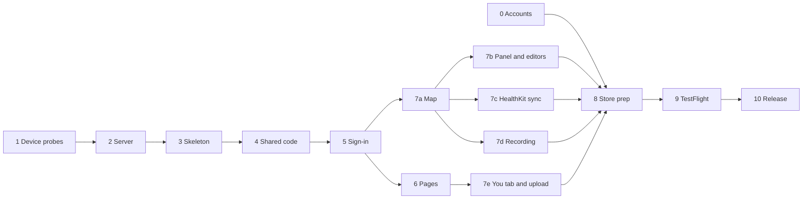

# HoldMyTrack for iOS — Roadmap

The iOS app's plan, from the first commit to the App Store. The shared code is built and nothing a user can run exists yet; the rest starts after the public launch. The product's open work is root `docs/ROADMAP.md`.

## How to work this plan

- **Phases run in the order of the graph below**; steps inside a phase run top to bottom. A step is done when its "Done when" holds, not when the code compiles.
- **Behavior is the Android app's** unless a step says otherwise: each step cites `apps/android/docs/SPEC.md` by FR, and lists only where iOS differs. A difference not listed is a bug, or a change to this plan made first.
- **One branch per phase, one commit per step**, with its documents in the same commit (`AGENTS.md`). The app's own `SPEC.md` and `IMPLEMENTATION.md` in this folder grow step by step, the way Android's describe Android; they are not written at the end.
- **Decisions in pure functions with unit tests** (`AGENTS.md`, "Code and tests"); rules shared across clients come from `testdata/client-rules/` (ADR-0049).
- **The server decides, the app applies** (ADR-0047, ADR-0048). A step that seems to need a look, a limit or a data rule in Swift needs it from the server instead.
- **Native only where the platform is the point**; every other screen is the site's page in a `WKWebView` (ADR-0042).
- A ticked step is deleted with its phase once every box in the phase is ticked.

## Decisions

Settled by the owner on 2026-10-24: D1–D12 in `apps/ios/docs/ARCHITECTURE.md` §1, which the steps below cite by number.

## Order

Phase 0 has lead times outside anyone's control, so it starts first and runs beside the rest. Phases 7b–7e can run in parallel once the map exists.

## Phase 0 — Accounts and identifiers

- [ ] **0.1 Apple Developer Program enrollment** ($99 a year, by D6)
  - An individual is approved in a day or two. An organization needs a D-U-N-S number first, up to a week, then a few days of review.
  - Done when: the account is active and two-factor authentication is on for the Apple ID that holds it.
- [ ] **0.2 App ID and capabilities**
  - Register D5's bundle ID with HealthKit and Sign in with Apple. Register a Services ID for Sign in with Apple on the web (2.2), with `holdmytrack.com` and its return URL, and create a Sign in with Apple key (`.p8`). Keep the key out of the repository, beside the server's other secrets (`docs/DEPLOY.md`).
  - Done when: both identifiers exist and the key is stored where production reads its secrets.
- [ ] **0.3 Private Email Relay**
  - Register `holdmytrack.com` and the address verification mail is sent from, and publish SPF for it, under Sign in with Apple's email communication settings. Without it, mail to a hidden `@privaterelay.appleid.com` address bounces, and such an account can never verify (`docs/SPEC.md` FR-1.8).
  - Done when: a test message from production's sender reaches a relay address.
- [ ] **0.4 App Store Connect record**
  - Create the app with the name HoldMyTrack, the bundle ID and an SKU. Accept the Free Apps agreement; no banking or tax forms are needed for a free app. File the Digital Services Act trader-status declaration, which the EU storefronts need.
  - Done when: the record exists and no agreement is pending.

## Phase 1 — Device probes

Confirm on a real device what HealthKit gives and how a recording survives the app being swiped away, before building on either. A throwaway app, not kept.

- [ ] **1.1 Probe app on an iPhone paired with an Apple Watch**
  - Request read access to workouts and workout routes only. Read 90 days of `HKWorkout`, then each one's `HKWorkoutRoute` through `HKWorkoutRouteQuery`.
  - Measure: how many workouts have a route, by source app (Apple's Workout, and any of Strava, Garmin Connect, COROS, Wahoo, Komoot, WorkOutDoors the tester uses); points per route and their spacing; whether altitude is present; time to read 90 days; what a read returns when access was denied, which HealthKit hides; and whether a read works with the phone locked.
  - Done when: the numbers are in root `docs/IMPLEMENTATION.md` §4.0 beside Android's Health Connect measurements, with the go or no-go for phase 7c.
- [ ] **1.2 Recording after a swipe**
  - Record with `CLLocationUpdate.liveUpdates` under a `CLBackgroundActivitySession` on When In Use access, then swipe the app away from the app switcher and keep walking. Apple describes relaunching an app the system terminated during such a session; whether a user's swipe counts is what this measures. Repeat after a reboot and with Low Power Mode on.
  - Also measure whether `applicationWillTerminate` runs on a swipe while recording, and whether a local notification posted from it is delivered.
  - Done when: the result (relaunched or not, and the gap from swipe to the next fix) is in `apps/ios/docs/IMPLEMENTATION.md`, with the choice of 7d.2's path.

## Phase 2 — Server prerequisites

Server changes the app depends on, deployed before any iOS build reaches a tester. Each updates `services/server/api/` and runs `npm run gen:api-types` where the contract changes (`AGENTS.md`).

- [x] **2.1 An iOS User-Agent and a minimum iOS build**
  - Recognize `HoldMyTrack-iOS/<version> (<sha>; <build>)` beside the Android agent (`app_outdated.go`), with `MIN_IOS_BUILD` refusing older builds with `426 app_outdated`, `/healthz` reporting `min_ios_build`, and the admin stats counting iOS builds as they count Android's. Extend `scripts/check-contract-release.sh` to `ios/<build>` tags.
  - Docs: root `docs/IMPLEMENTATION.md` §4.33 covers both platforms; `docs/DEPLOY.md` §10 gets the iOS procedure.
  - Done when: a request with an iOS agent below the minimum gets `426`, and the server tests cover it.
- [ ] **2.2 Sign in with Apple**
  - Built (root `docs/SPEC.md` FR-1.14): the web flow, `POST /v1/auth/apple/token` taking the app's authorization code, revocation on account deletion, and Apple's notifications. Left: configure it on production once 0.1–0.3 are done (`docs/DEPLOY.md` §4).
  - Done when: a new account, an existing verified email and a relay email each sign in on the web, and deleting the account revokes the token.
- [x] **2.3 Pages tell the platforms apart**
  - Set `hmt_app` to `android` or `ios` and let a page say the platform's words: Health Connect or Health, Google Play or the App Store. Audit Help, About, Privacy and the in-app pages for Android-only wording.
  - Done when: each in-app page read with `hmt_app=ios` has no Android wording, and the public cache key still separates the values.
- [ ] **2.4 The native OAuth round trip from iOS**
  - Check that Google's and Facebook's flows complete in `ASWebAuthenticationSession` with `holdmytrack://oauth` as callback, against a dev stack and production. No server change is expected; a needed one is made here.
  - Done when: both providers return a code that `POST /v1/auth/handoff` redeems.

## Phase 3 — Project skeleton

- [ ] **3.1 The Xcode project** (D1–D5)
  - `apps/ios/HoldMyTrack.xcodeproj` with an app target, a unit-test target and a UI-test target; MapLibre Native iOS through SPM, pinned to an exact version that reads `pmtiles://` (6.10.0 or later).
  - Configurations: Debug reads the API origin from an `.xcconfig` the developer sets (a simulator reaches the host's `localhost:8081` directly) and allows cleartext to it alone; Release is fixed to `https://holdmytrack.com`, and no Debug value can leak into it.
  - The build number from `git rev-list --count` (D9) and the short SHA, written by a build phase; the User-Agent from phase 2.1.
  - Done when: a Release archive validates in Xcode's Organizer, and a Debug build on the simulator reaches a dev stack's `/healthz`.
  - Built, with MapLibre 6.31.0; the simulator half is met. Left: the archive, once 0.1 gives a team.
- [x] **3.2 Visual language**
  - The web's `--fm-*` tokens as an asset catalog of named colors with light and dark values, Inter and Fraunces bundled with Source Serif 4 for Russian headings, and the Lucide icons as template images (`docs/ARCHITECTURE.md` §1.1). Root `docs/IMPLEMENTATION.md` §4.19's "Keep in step" adds iOS.
  - Done when: a sample screen matches Android's in both themes.
- [x] **3.3 Languages**
  - One String Catalog with English and Russian. Russian counts written as "label: N", as Android's. Accept-Language sent from the app's resolved language.
  - Done when: the build fails on a string missing its Russian.
- [x] **3.4 CI**
  - `.github/workflows/ios.yml` builds the app and runs its unit tests on a macOS runner for pull requests touching `apps/ios/`, `testdata/client-rules/` or `services/server/api/`; its own workflow, so the path filter spares every other pull request. Documented in `docs/DEVELOPMENT.md` ("CI").
  - Done when: a failing unit test fails the pull request.
- [x] **3.5 Documents**
  - `apps/ios/docs/` has its own `ARCHITECTURE.md` (shape, D1–D12 with reasons, stack), `SPEC.md` and `IMPLEMENTATION.md` on Android's outline and numbers; Android's shape, decisions and stack moved the same way to `apps/android/docs/ARCHITECTURE.md`, leaving root `docs/ARCHITECTURE.md` §3 and §4 a paragraph each. `AGENTS.md` covers both apps' documents and budgets; the root `README.md` lists the folder; `apps/ios/README.md` says how to build and run.
  - Done when: `scripts/check-doc-refs.sh` passes.

## Phase 4 — Shared code under test

- [x] **4.0 A package for what needs no device**
  - `apps/ios/HoldMyTrackCore`, a local Swift package the app depends on, holding the code with no UIKit in it: the wire models (4.1), the client rules (4.2) and every other decision made over plain values, starting with the build info and `/healthz` reading 3.1 put in the app. Its tests run with `swift test` on the Mac in seconds, with no simulator to boot and no app to build; the app keeps what needs UIKit, and the UI tests.
  - CI's iOS job runs `swift test` before the simulator tests, so a broken rule fails in seconds. It runs them with coverage and uploads `llvm-cov`'s lcov export to Codecov under a `swift` flag; `codecov.yml` sets that flag to carry forward, since the iOS workflow skips changes outside its paths, and the README gets a Swift coverage badge beside Go's, TypeScript's and Kotlin's.
  - Done when: the package's tests pass with `swift test`, CI runs them and the Swift badge shows their coverage, and the app's test target holds only tests that need the app.
- [x] **4.1 Wire models**
  - In the package (4.0), `Codable` types for every request and response the app uses, held to `services/server/api/` by `WireContractTests`, as Android's is: every model reached by a check, unknown fields refused in the test.
  - Done when: renaming a field in the contract fails the iOS suite.
- [x] **4.2 Client rules**
  - In the package (4.0), a test that runs every file in `testdata/client-rules/` and fails on one with no Swift implementation (ADR-0049); then implement each rule as a pure function, `cases` and `generated` alike.
  - Done when: every file passes, and adding an empty rule file fails the suite.

## Phase 5 — Sign-in and session

`apps/android/docs/SPEC.md` FR-1.1–FR-1.4 and FR-1.8.

- [ ] **5.1 API client and session**
  - `URLSession` with the bearer token sent to the API's own origin only, never to the basemap or imagery origins (`apps/android/docs/SPEC.md` §8). The token in the Keychain, device-only; the Keychain outlives an uninstall, so a first launch with no `UserDefaults` marker deletes what it holds.
  - Cold start: no signed-in layer until `GET /v1/auth/me` answers; only `401` signs out (`apps/android/docs/SPEC.md` FR-1.2).
  - Done when: the session rules are pure functions with tests, and a restart with the server down keeps the session.
- [ ] **5.2 Sign-in screen**
  - Email and password, sign up and demo against the web's endpoints, with the server's messages shown as sent. Providers shown only when `GET /v1/auth/providers` reports them. Sign in with Apple through `ASAuthorizationAppleIDButton` and phase 2.2's endpoint; Google and Facebook through `ASWebAuthenticationSession` and the handoff (D7). Forgot password in `SFSafariViewController`.
  - Done when: each way in reaches the map on a real device against production.
- [ ] **5.3 Verification, sign-out and Update**
  - The "check your email" screen (`apps/android/docs/SPEC.md` FR-1.4), sign-out (`apps/android/docs/SPEC.md` FR-1.3), and the Update screen on any `426` (`apps/android/docs/SPEC.md` FR-1.8), which opens the App Store listing.
  - Done when: a dev stack with `MIN_IOS_BUILD` above the build shows the Update screen once, over any screen.
- [ ] **5.4 Per-account local state**
  - Everything kept on the phone is keyed by the account's email, the demo account with a key of its own (`apps/android/docs/SPEC.md` FR-5.3).
  - Done when: two accounts on one phone never see each other's recordings, hidden rows or HealthKit switch, under test.

## Phase 6 — The site's pages

`apps/android/docs/SPEC.md` FR-1.5, FR-1.6, FR-4.1 and About (ADR-0042, root `docs/IMPLEMENTATION.md` §4.19).

- [ ] **6.1 `WKWebView` signed in**
  - Set the session cookie and `hmt_app=ios` in the web view's `WKHTTPCookieStore` before the first load. Where a link goes is the `webPageRoute` rule (`testdata/client-rules/web-page-route.json`), shared with Android. Read the session again on leaving a page, since a page may change units, the name or the language.
  - Done when: the rule's cases pass, and saving Settings changes the map's units on return.
- [ ] **6.2 Settings, Profile, Sync history, About**
  - First run: a verified account with no Country opens Settings, and only saving gets past it. The avatar uses the page's file input, which iOS answers with its own photo picker. Sync history's View on map opens the native map on that activity (`apps/android/docs/SPEC.md` FR-4.1).
  - Done when: each page works offline with an error and Try again, and in both languages and themes.

## Phase 7a — The map

`apps/android/docs/SPEC.md` FR-2.1–FR-2.6 and FR-2.9.

- [ ] **7a.1 Two documents**
  - Fetch `GET /v1/map/style/{flavor}?lang=` and `GET /v1/map/layers?flavor=` in parallel, keep both with their ETags, draw the kept pair at once on a later launch and revalidate; fetch the style again when the two carry different builds (ADR-0048). Insert the layers by `layer-insertion.json`'s rule, binding `["var", …]` from the app's state.
  - The bearer token on tile requests to the API's origin only, through MapLibre's network configuration.
  - Done when: a server deploy that changes a layer's color changes it on the phone without an app release.
- [ ] **7a.2 Modes, Layers and framing**
  - Normal, Fog of War and Heatmap; the Layers menu; first framing; the empty account's pointer to Sync; attribution kept visible; Find my location; theme and language reloading the style and keeping the camera.
  - Done when: `apps/android/docs/SPEC.md` FR-2.2–FR-2.5 hold on iOS.
- [ ] **7a.3 Tab bar and date range**
  - Map, Stories, the record button, Sync and You (`apps/android/docs/SPEC.md` FR-2.9), each keeping its state. The date slider (`apps/android/docs/SPEC.md` FR-2.6) from the slider rules.
  - Done when: a picked range survives a trip to every tab and a rotation.

## Phase 7b — Panel, editors, Spots, photos, export

`apps/android/docs/SPEC.md` FR-2.7, FR-2.8, FR-2.10 and FR-2.11.

- [ ] **7b.1 Activities and Stories panel**: rows, filters, selection, checked group, toolbar, Edit, Delete, Add to story, Pending polling, the Stories tab with copies to accept or decline. Done when: the panel rules' cases drive it and it behaves as `apps/android/docs/SPEC.md` FR-2.7 describes.
- [ ] **7b.2 Track editor and Private location editor**. Done when: each operation matches the `edit-track-*` cases on a real track, and a Private location saves and clips.
- [ ] **7b.3 Spots and capture**: layers per category, the popup, capture by 30 seconds within 25 m in the foreground with precise location, the screen kept awake. Done when: a capture at a real place is accepted by the server.
- [ ] **7b.4 Photos**: `PHPickerViewController`, redrawn upright at most 2,048 px with a 320 px thumbnail, placed by the server's check or by hand. iOS's picker may keep a photo's location, unlike Android's: measure it and say so in this app's `SPEC.md`. Done when: photos added, moved and deleted through Save survive a reload.
- [ ] **7b.5 Map image export**: the viewfinder and presets, saved to Photos with add-only access and offered to the share sheet. Port Android's approach (`apps/android/docs/IMPLEMENTATION.md` §3.5). Done when: an exported image shows exactly the window, with the credit and the mark.

## Phase 7c — HealthKit sync

`apps/android/docs/SPEC.md` FR-3.1–FR-3.5, with HealthKit in Health Connect's place. Go only on phase 1's result. The gate rule holds: nothing ticked, nothing sent unasked, nothing guessed (ADR-0039).

- [ ] **7c.1 Settings › Sync and access**
  - A switch per account, off at first. Turning it on asks for workouts and workout routes and nothing else; never heart rate or any other body signal (ADR-0017). `NSHealthShareUsageDescription` says only the routes are read.
  - Readiness differs from Android's six states: HealthKit never says whether reading was denied. States: unavailable, not yet asked, asked. When asked and nothing is found, the list says where to check access (Settings › Health › Data Access & Devices).
  - Done when: the readiness rule is a pure function with tests, and no health type beyond the two is in the entitlement or the request.
- [ ] **7c.2 Load and the list**
  - Load reads workouts started in the last 90 days with a route of at least 2 points, in the foreground only, with no `HKObserverQuery` or background delivery. External id is the workout's UUID. `POST /v1/sync/known` leaves out what the account has; overlaps are marked as a hint; swiping hides a row (`apps/android/docs/SPEC.md` FR-3.2, FR-3.5).
  - Workout types map onto HoldMyTrack's in one table under test, so the Type filter matches Android's.
  - Done when: phase 1's device lists the same workouts as the probe found.
- [ ] **7c.3 Sending**
  - Ticked rows under `healthkit`, in batches of at most 25 activities or 20,000 points, the route read again by UUID; a route over 50,000 points refused by the app; ingest polled every 2 seconds; refused rows kept ticked with their reason (`apps/android/docs/SPEC.md` FR-3.4).
  - Done when: a ticked workout lands on the map, a second send makes no second activity, and leaving mid-run loses nothing.

## Phase 7d — Recording

`apps/android/docs/SPEC.md` FR-5.1–FR-5.2 (ADR-0007).

- [ ] **7d.1 Recording**
  - `CLLocationManager` with the `location` background mode, `allowsBackgroundLocationUpdates` and the background indicator, on When In Use access only; precise location required (ask for temporary full accuracy when reduced). Pause and resume by tap, stop by a 2-second hold, the map showing only the recording.
  - A Live Activity in place of Android's notification, with Pause or Resume; its Stop opens the app to confirm.
  - Difference: swiping the app away on iOS ends location updates, where Android's foreground service keeps going. 7d.2 brings the recording back; the first recording says once that swiping the app away stops it.
  - Done when: a 30-minute walk with the screen off records every fix.
- [ ] **7d.2 Journal and recovery**
  - Every fix written to SQLite as it arrives; after a crash the map offers Resume, Save or Discard (`apps/android/docs/SPEC.md` FR-5.1).
  - After a swipe, always: post a local notification as the app terminates ("Recording paused: HoldMyTrack was closed"), whose tap resumes the recording.
  - After a swipe, if 1.2 found the app relaunched: on a background relaunch with a recording in the journal, recreate the session and resume by itself, with no prompt.
  - Either way the time the app was dead counts as a pause: no time or distance added, the first fix after it starting afresh. The rule choosing resume, prompt or nothing is a pure function of the journal's state and the launch reason, with tests. This app's `SPEC.md` states which path shipped.
  - Done when: after a swipe mid-walk, the recording carries on by itself, or one tap on the notification brings it back, with every fix before the swipe kept.
- [ ] **7d.3 Recordings on the Sync tab**
  - Edit, Download GPX through the share sheet, Delete, and sending under `recorded` (`apps/android/docs/SPEC.md` FR-5.2).
  - Done when: a recording lands on the map and leaves the phone only then.

## Phase 7e — You tab, Privacy, upload

`apps/android/docs/SPEC.md` FR-1.7, FR-2.9 and FR-3.6.

- [ ] **7e.1 You tab**: account card, theme (kept on the phone), Language (D11), About in the app, Help and Contacts in the browser, the version and commit. No Donate: App Review allows payment links only through Apple's purchase system, with exceptions to recheck before relying on one. Done when: it matches Android's tab apart from Language.
- [ ] **7e.2 Privacy**: Private locations, Download your data saved through the share sheet or Files, the privacy policy. Done when: an archive downloads and opens in Files.
- [ ] **7e.3 Delete account**: confirmed by typing the email; on success the phone deletes that account's recordings, hidden rows, HealthKit switch and last Load, then signs out. Done when: a deleted account leaves nothing on the phone, and an Apple-linked one is revoked (2.2).
- [ ] **7e.4 Upload**: `.gpx`, `.fit` and `.tcx` declared as document types the app opens, picked in the document picker or shared from Files and other apps, sent one at a time on a background `URLSession` so they carry on when the screen is left. The web's limits apply (`apps/android/docs/SPEC.md` FR-3.6). Done when: a file opened from Files and one shared from another app both import.

## Phase 8 — App Store preparation

- [ ] **8.1 Accessibility and layout**: VoiceOver labels on every control, 44-point targets, Dynamic Type with rows stacking at large sizes, landscape clear of the notch and home indicator, iPhone SE to Pro Max. Done when: every screen can be used with VoiceOver alone.
- [ ] **8.2 Privacy declarations**
  - `PrivacyInfo.xcprivacy` with the required-reason APIs the app and its packages use; App Privacy answers in App Store Connect (location, email, name, photos, user content; nothing for tracking); `ITSAppUsesNonExemptEncryption` false (HTTPS only).
  - The privacy policy, `docs/DPIA.md` and Help name HealthKit and what is read from it.
  - Done when: an archive uploads with no privacy-manifest warning, and the declarations match the DPIA.
- [ ] **8.3 Listing**: description and keywords naming no other platform and promising no device Apple's or HealthKit's data can't deliver; 6.9-inch iPhone screenshots in English and Russian with no real account's details; age rating; support URL `https://holdmytrack.com/contacts`; privacy policy URL. Done when: the listing is complete in both languages.
- [ ] **8.4 Review notes**: a reviewer account, verified and holding activities, kept apart from the demo account; a short screen recording of HealthKit sync and of recording in the background, since the reviewer has neither a watch history nor a walk; one line on each permission's use. Done when: the notes are in App Store Connect.

## Phase 9 — TestFlight

- [ ] **9.1 Internal testing**: builds uploaded from Xcode's Organizer (or `xcodebuild -exportArchive` with an App Store Connect API key, documented in `docs/DEPLOY.md` §10); the owner and developers as internal testers. Done when: a build installs from TestFlight and passes phases 5–7 on a device.
- [ ] **9.2 External testing**: a public TestFlight link after Beta App Review. Apple sets no minimum number of testers or days; run until the app has been tested on at least two iPhone models and one Apple Watch history. Done when: no open issue blocks release.

## Phase 10 — Release

- [ ] **10.1 Submit for review**: manual release, phased over 7 days. A rejection is answered in Resolution Center or fixed in a new build, and the reason goes into this plan's phase 8 for next time. Done when: approved.
- [ ] **10.2 Release**: tag the commit `ios/<build>`; `MIN_IOS_BUILD` stays 0 until a contract break needs it (`docs/DEPLOY.md` §10). Root `docs/ROADMAP.md` drops the iOS item; `apps/android/docs/SPEC.md` §9 drops "No iOS app". Done when: the app is on the App Store in every storefront chosen, and this file holds only what remains.