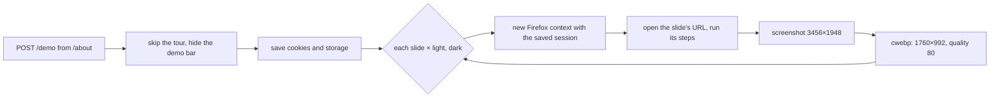

# Landing shots

`shoot.mjs` retakes the About page's carousel screenshots (`services/server/internal/web/static/landing/`) on production as the demo user, light and dark. Each slide keeps the view and state it had before, so a retake changes only what the app itself changed. Run it after a release that changes what a slide shows: a renamed label, a new control, a restyled map.

## Running it

From `apps/web`, after `npm ci`:

```sh
npx playwright install firefox   # once; the tests use Chromium
brew install webp                # cwebp
npm run shots:landing            # every scripted slide
npm run shots:landing -- trip    # one or more slides by name: map, trip, track, profile
```

The script overwrites `<slide>.webp` and `<slide>-dark.webp` in `static/landing/`. A run with nothing changed in the app writes the same bytes, so git shows no change. Review a changed one in the pull request, where GitHub's 2-up and Swipe views compare it against the committed one.

Production allows 5 demo sessions an hour from one address (`demoLimiter`, `internal/httpapi/auth.go`). The script signs in once per run, so 5 runs an hour; a sixth fails at sign-in until the hour is up.

## How it works



The shots match the original ones, taken in Firefox full screen on a MacBook whose screen is 1728×1117 points: a 1728×974 CSS viewport at 2×, scaled to 1760×992, which keeps the page's 380 px panel at 388 px in the image. Quality 80 matches the committed files' sizes. The originals are Firefox's, so the script uses Firefox.

Each slide in `SLIDES` is a start URL and a `run(page)` that sets its state:

| Slide | View (`#map=`) | State |
| :-- | :-- | :-- |
| `map` | `10.98/41.4474/-81.6404` | Places on (Mesmerizing views, Waterfalls, Historic sites) and loaded with "Show places in this area"; "Evening loop" and "Oct 3, 2026, 12:46 PM" checked; "Oct 4, 2026, 03:18 PM" focused |
| `trip` | `10.84/41.4238/-81.6337` | Trips tab, "Greater Cleveland trails" open; Places off with its three categories picked |
| `track` | `14.48/41.36756/-81.83282`, turned about 45° | Satellite, Places on; "Lake to Lake Trail" focused; the tunnel photo open |
| `profile` | `/profile` | Scrolled so the stat cards sit 7.85 CSS px below the top |

`camera.mjs` holds the arithmetic for steering the map, unit-tested in `tests/landingShotsCamera.test.mjs`.

## Traps

- **Focusing a track flies the camera to it.** The URL hash can't hold the view through a focus, so `steer` sets it afterwards: it scrolls the wheel to the zoom, then drags to the centre, reading `#map=` back after each move until it is within a pixel.
- **A short drag is a click.** A drag inside MapLibre's click tolerance reads as a click on the map and clears the focused track, so `steer` pans with two drags of at least 80 px that sum to the offset (`dragSplit`).
- **The hash has no bearing.** The track slide is turned with a right-drag of −57 px (0.8° per pixel); the photo click after it depends on that turn. The run fails when no photo marker is at `TUNNEL_PHOTO` or no popup opens, rather than click the map and lose the focus.
- **First-use cards and the tour** appear for a fresh browser. Sign-in skips the tour; the Trips slide closes its card when it shows. Those clicks pass over a prompt that isn't there, so before each shot the run fails if the tour, its offer, a first-use card or the demo bar is still on screen.
- **A fresh browser has no Places categories picked**, so every map slide picks them; the count beside Places would read 0 otherwise.

## Changing or adding a slide

Set the view from the shot it should match, not from memory. Pick at least three landmarks spread across the map (a city label near each edge, or road shields), measure their pixel positions in the old shot and in a trial shot at a known view, and solve for zoom and centre: zoom from the ratio of their distances (`log2` of it), centre from the offset of one landmark. Two labels close together can put the zoom off by 0.15, enough to cut off a Trip's outer routes. Then compare the result against the old shot in GitHub's Swipe view.

## Not covered

- The five fog slides (`fog-exact`, `fog-city`, `fog-county`, `fog-state`, `fog-country`) are not scripted; add each to `SLIDES` the same way when one needs a retake.
- The Play store screenshots in `brand/play/` come from the Android app and have their own tooling there.