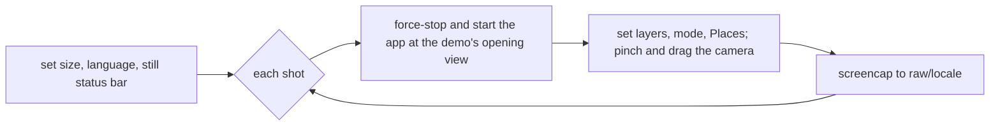

# Play listing screenshots

`shoot.mjs` retakes the phone's raw captures on the Android emulator as production's demo account, one set per language in `raw/<locale>/`; `render.mjs` draws the callouts in `phone.json` over them into `brand/play/<locale>/`.

## Running it

From the repository root, after `npm ci` in `apps/web` (for Playwright), with the emulator running, a release build installed (it talks to production) and signed in with **Try the demo**:

```sh
node brand/play/source/shoot.mjs en                 # every shot in one language
node brand/play/source/shoot.mjs ru 02-fog 08-profile
node brand/play/source/render.mjs brand/play/source/phone.json en brand/play/en
node brand/play/source/render.mjs brand/play/source/phone.json ru brand/play/ru
```

The script sets the screen to 1080×1920 at 420 dpi with `wm` and the app's language with `cmd locale`, and restores both, the location and the status bar when it ends, failed or not. A callout's `en` and `ru` hold its text, and may also hold an `x`, `y`, `w` or `to` of their own where the languages' layouts differ.

## How it works



Each shot starts from the account's opening view, so the same pinch and drags give the same camera every run. To tune a shot's numbers against its committed capture, measure two labels in the committed capture and in a trial one, take the zoom from the ratio of their distances (`log2`) and the drag from the offset of one.

## Traps

- **`adb shell input` has one finger.** Pinches and drags go through the emulator console (`adb emu event send`) on the touch panel's 0–32767 axes; the `wm size` override is letterboxed inside the panel, which `toPanel` accounts for.
- **A short pinch is ignored.** The map ignores a pinch whose spread changes by less than about 720 px, so `zoomPlan` pinches 2 to 3 levels and makes up the rest with taps of one level each (`rules.mjs`, tested in `apps/web/tests/playShots.test.mjs`).
- **A pinch zooms about half a level less than its levels**, the part of the spread the map ignores, so a pinch's levels are the measured zoom plus that shortfall, confirmed by a trial capture.
- **A drag that lifts while moving flings.** Every gesture rests before lifting.
- **The profile is a WebView**, which UI Automator can't see into, so its rows are tapped at measured positions, per language. Choosing Month reloads the page and scrolls it to the top, so it goes first.
- **The Trip shot is framed by hand.** Its view sits half a level inside the Trip's fit, and no gesture gets there the same way twice: a tap on the Trips map picks the route under it, a half-level pinch is ignored, and the Trip's own flight moves what follows. `shoot.mjs 04-trip` takes it at the fit; for the listing, set the screen to 1080×1920 at 420 dpi, frame Greater Cleveland trails by hand with its totals showing, and capture `raw/<locale>/phone-04-trip.png` with `adb exec-out screencap -p`.
- **Edit is closed to the demo account**, so the listing has no Edit shot.
- **The location dot greys out** on a stale fix; the Spots shot sends a fresh one from a test provider just before the capture.