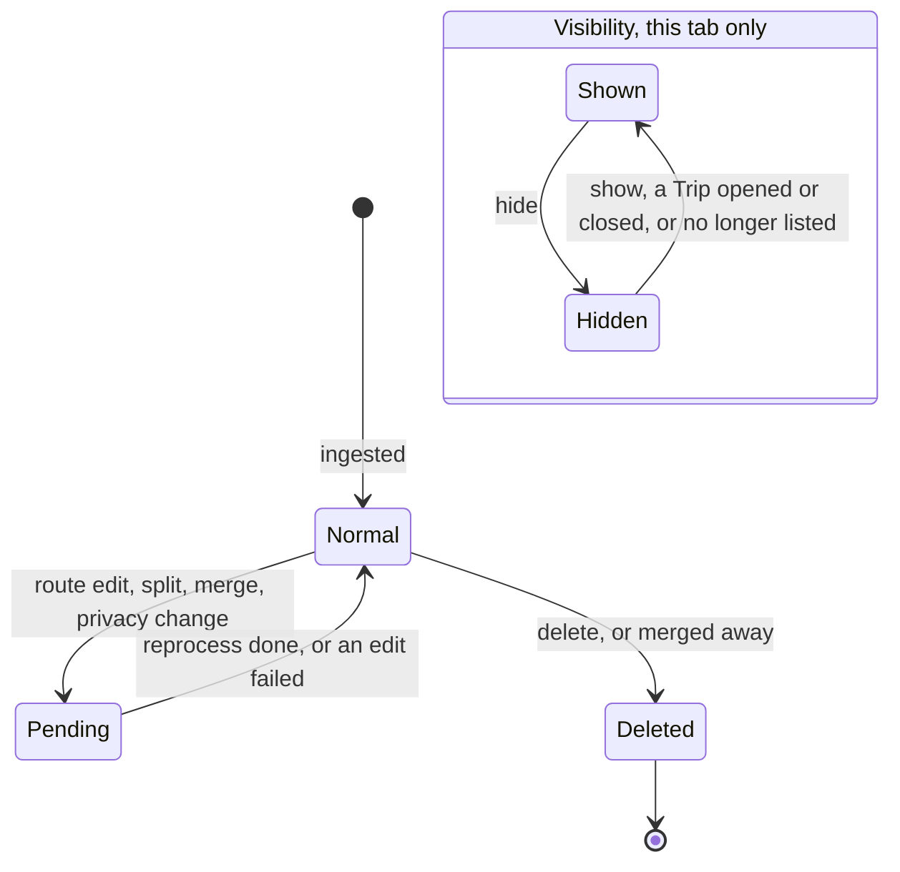
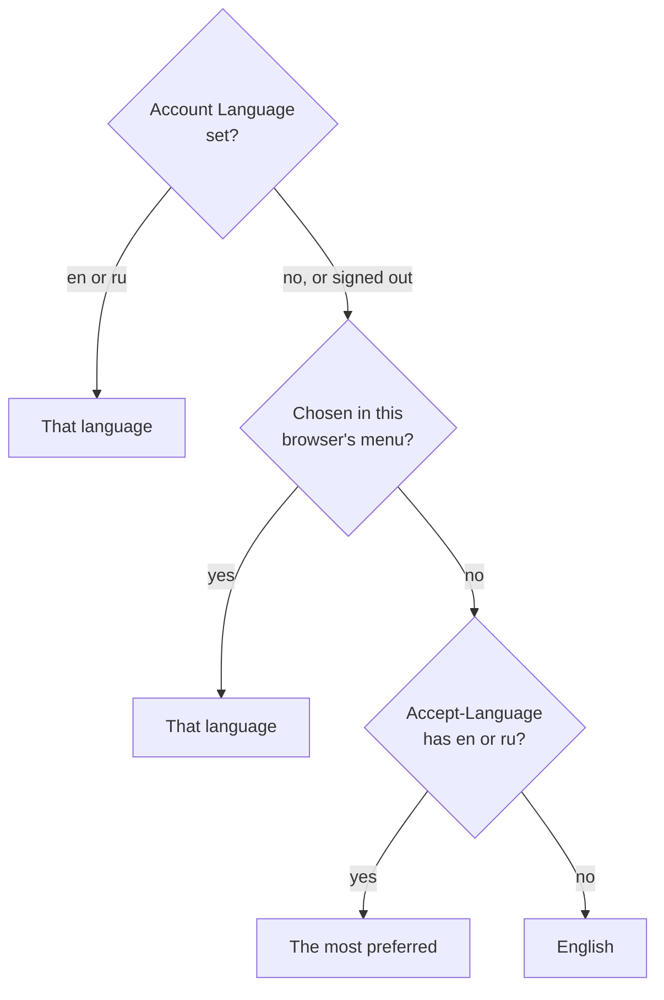

# HoldMyTrack: Spec

| | |
| :-- | :-- |
| **Status** | Current: as built |
| **Related documents** | `VISION.md` (what ships and why), `IMPLEMENTATION.md` (how it's built), `services/server/api/` (the JSON contract), `apps/android/docs/SPEC.md` (the Android app) |

## 1. Introduction

### 1.1 Purpose

What HoldMyTrack does, as a user or an API client can rely on it: limits, privacy guarantees, what is kept and deleted, and the rules that cross features. Wording and layout live in the UI code, parameters and status codes in `services/server/api/`, reasons in the ADRs, design in `IMPLEMENTATION.md`.

### 1.2 Scope

Every built feature of the server and the web app; the Android app's own behavior is in `apps/android/docs/SPEC.md`. What won't be built is in §21; what isn't built yet is in `ROADMAP.md`.

### 1.3 Definitions

| Term | Meaning |
| :-- | :-- |
| **Track** | One recorded outing with a start time and usually a GPS route. Never any heart rate or other health data (ADR-0017). |
| **Original** | The file uploaded or the record synced, kept as it arrived so the track can be rebuilt from it. |
| **Registered user** | An account with an email and password, a linked Google or Facebook identity, or both. |
| **Demo user** | A visitor in a session on the shared, read-only Demo Customer account (FR-2). |
| **Fog of War** | A map mode that veils everywhere the account has never recorded a track. |
| **Per-address limit** | A limit counted per caller IP address ("from one address"), an IPv6 one together with the rest of its /64. |
| **Ingest** | Turning an original into a stored track: parsing, clipping against Private locations (FR-7.1), simplifying, storing. |

### 1.4 API errors

Every error from `/v1`, `/v2` and `/tiles/v1` is JSON `{"error": code, "message": text}`: the code is stable and never changes with language, and the message is a sentence in the request's language (FR-12.1); `services/server/api/` lists the codes. An app build older than the deployment's minimum for that app is refused on every `/v1` request before anything else is checked, and asked to update (`apps/android/docs/SPEC.md` FR-1.8); no other client is ever refused for its version.

## 2. Actors

| Actor | Can |
| :-- | :-- |
| **Anonymous visitor** | Read the public pages (FR-9), sign up, sign in, start a demo. Sees no track data. |
| **Demo user** | Read everything the Demo Customer account holds and change nothing (FR-2.1). |
| **Registered user** | Everything in this document, for their own account. |
| **Admin** | A registered user made admin from the command line, who can also read every account (FR-11). |

The admin panel is the only place an account sees another account's data (FR-7.2).

## 3. FR-1 — Authentication & Account Management

On the web, sign-in, sign-up, password reset and verification are server-rendered pages sharing the JSON endpoints' behavior. A page form, and any `POST`, `PATCH` or `DELETE` under `/v2/` that carries an `Origin`, is refused unless that `Origin` (for a form without one, its `Referer`) is the app's own. A request with no `Origin`, as Android's, is not refused.

### FR-1.1 Sign up

- The email must be a bare address: a display name or comment (`Name <a@b.c>`) is refused. An email another real account has is refused.
- The password is 8 characters to 72 bytes (bcrypt's limit), stored as a bcrypt hash, never stored or logged in plain text.
- The browser's IANA timezone comes with the form; a missing or invalid one starts the account on UTC and never refuses the signup.
- At most 5 accounts from one address in an hour. Failed signups and Google or Facebook sign-ins don't count.
- The web sign-up page asks Cloudflare Turnstile whether the visitor is a person, when the deployment turns it on, and refuses the signup without its pass.
- The apps sign up on that page, opened in a browser tab. The account it makes is signed in only in the app, never in the tab's browser.
- Signing up always makes a new account, also from a demo session (FR-2.3), starts a 30-day session and sends a verification email (FR-1.8).

### FR-1.2 Sign in

- An unknown email, an account with no password and a wrong password get the same error in the same time, so sign-in can't reveal which emails have accounts.
- After 10 failed sign-ins for one email, or 50 from one address, within 15 minutes, sign-in is refused before the password is checked, even the right one, until the window passes.

### FR-1.3 Sign out

Signing out deletes the session on the server; its cookie or token stops working at once.

### FR-1.4 Session check / persistence

- Every request checks the session in the database, so a session ended on the server (sign-out, password reset, account deletion) stops at once. A session lasts 30 days from creation, a demo session 24 hours.
- `GET /v2/auth/me` returns the account and whether its email is verified (always true for a demo session).
- When the check gets no answer (the server unreachable or failing), the map says it couldn't load the account and offers to retry; it doesn't treat the visitor as signed out. A check the database can't answer is a 503, never the 401 that means the session is gone; a page whose check can't be answered says the site is briefly unavailable, never showing the visitor signed out or sending them to sign in.

### FR-1.5 Forgot password

- A reset link goes to a real, claimed account, including a Google- or Facebook-only one, which is how such an account gets its first password. It is valid for 1 hour and works once.
- The answer is the same, and as quick, whether or not the email has an account.
- At most 5 requests an hour from one address.

### FR-1.6 Reset password

- The password rules are FR-1.1's. A missing, used and expired token get the same error.
- A reset ends every session, every app sign-in not yet completed and every outstanding reset link of the account, then signs in the browser that made it.
- A reset of an account whose email isn't verified yet drops its Facebook link, which whoever owns the address may not have made.
- A reset link opens the reset page whatever session the browser holds.

### FR-1.7 Account settings

- **Avatar**: PNG, JPEG or WebP up to 5 MB, stored upright without its metadata.
- **Name**: an optional label; not unique, and nothing signs in with it.
- **Country** (required in every save) decides the units everywhere: imperial for the United States, Liberia and Myanmar, metric for every other country and for an account that has never saved one.
- **Timezone** (IANA, UTC until changed, a former name stored under its current one) decides "today": where Dates' pickers and Trends' default window end, and the track graph's current year. It stands in for a track's zone where that isn't known (FR-3.8).
- **Language**: automatic (the default), English or Russian (FR-12).
- Name, Country and Timezone (and Language, over the API) save together: one invalid value and nothing is saved.
- **First run**: a real, verified account that has never saved Country is sent to Settings from the map, Profile and sign-in until it saves Country and Timezone once.
- A demo account's settings are read-only. The theme belongs to the browser or phone (FR-4.8).

### FR-1.8 Email verification

A real account must confirm its email before using anything else. Why: a mistyped email strands an account's imported data where nobody can get it back.

- Until verified, every route except `GET /v2/auth/me`, sign-out, resend, change of address and typing the code is refused with a distinguishable error. A demo account is never gated.
- Each verification email carries a 6-digit code beside its link. The code verifies only when typed by someone signed in to the account, who stays signed in. It works for 30 minutes and five wrong tries, and only the newest email's code works. Past ten wrong codes in an hour for one address, from any accounts, every code for it is refused until the hour ends.
- A link is valid for 24 hours, works once and confirms only the address it was sent to, from any device. Opening it confirms the address at once only in a browser already signed in to its account; anywhere else the page asks for a press of its button first, so a mail scanner that opens every link in a message can't confirm an address. A browser already signed in to the link's account carries on; any other, signed out or signed in to another account, gets the address verified but is not signed in to it, and signs in the usual way. A first verification, by link or code, also ends the account's other sessions and app sign-ins not yet completed. An account linked to Facebook is first verified only in a browser signed in to it: anywhere else the link verifies nothing and stays usable. A Facebook sign-in started from the link comes back to it, signed in only when it is the account's own Facebook; a password reset is the other way in (FR-1.6).
- Verifying, by link or code, ends every other verification link and code, and, when the address changed, every reset link.
- A change of address before verifying waits for the new address's link: until then the account keeps its address and state, the new address stays free for anyone else, and earlier links stop working. If another account takes the address meanwhile, verifying is refused.
- A change to an address another account has, or is confirming, is refused. A resend goes to the newest link's address. Resends and changes together: at most 5 an hour per account; a demo account can do neither.
- An account not verified 7 days after signing up, and with no link still valid, is deleted with everything it holds, which frees its address.

### FR-1.9 Sign in with Google

- Offered only where the deployment configures Google; otherwise its endpoints don't exist.
- A Google account whose email Google reports unverified is refused.
- The account is, in order: the one linked to this Google account, even if its email changed; else a real account with the same email, which is linked and counts as verified from then on; else a new verified account, named from the Google profile, on the browser's timezone (UTC if none).
- Linking an unverified account also removes its password and other provider links and ends its sessions and links: whoever set them never proved they own the address.
- An account linked to a different Google account isn't relinked; the sign-in fails. Every failure gets one generic message, the cause logged on the server only.
- Kept from Google: the stable id, email and name. The Android app sends a Google ID token for the same checks.

### FR-1.10 Sign in with Facebook

- Offered only where the deployment configures Facebook.
- Never linked to an existing account by email, because Facebook doesn't say whether the email is verified: an email another account has is refused, pointing to the usual sign-in or a password reset. There is no way to link Facebook to an existing account.
- A Facebook account that shares no email is refused.
- An account linked to the Facebook account signs in even if its email changed; otherwise a new, unverified account is made and sent a verification email (FR-1.8).
- Kept from Facebook: the app-scoped id, email and name. The Android app runs the flow in a browser tab and gets its session with a one-time code valid for 2 minutes and tied to the app's S256 challenge; a wrong verifier uses it up.

### FR-1.11 Sign in with Apple

- Offered only where the deployment configures Apple.
- The account is found as for Google (FR-1.9): the one linked to this Apple ID, else a real account with the same email, linked and verified from then on, else a new verified account. Apple vouches for the email, so one it reports unverified is refused.
- An address hidden with Hide My Email is Apple's relay address, kept as the account's email; it never matches an existing account.
- Kept from Apple: the stable id, the email, the name Apple sends on the first sign-in only, and a refresh token used for nothing but revoking the link. The iOS app sends the authorization code Apple gave it, for the same checks.
- Stopping Sign in with Apple for HoldMyTrack at Apple, or deleting the Apple ID, removes the link and ends the account's sessions. The account stays, reachable with its password or a reset.

Every provider: a provider-only account has no password and can set one through FR-1.5; changing the email keeps the links; a Facebook-made account still unverified when its email signs in with Google or Apple loses its Facebook link.

### FR-1.12 Delete account

- A real account, verified or not, confirms by typing its email (case and surrounding spaces ignored). A demo session can't.
- At once: every session ends, the provider links and every unused reset, verification or app sign-in link stop working, nothing can sign in, and the email is free for a new account. An Apple link's access is revoked at Apple too (FR-1.11).
- Within minutes: tracks and originals, tiles, photos, Trips, Private locations, captures, import history, data downloads, avatar and settings are deleted. A file being processed finishes first, and an object-storage outage holds the deletion until storage is back, so nothing is left behind.
- Backups keep the data for up to 8 weeks. Trip copies others accepted stay theirs (FR-13.8).
- The Android and iOS apps also clear the account's unsynced recordings on that phone. An unverified account deletes on the web by verifying first, or by email (FR-9.2).

### FR-1.13 Download your data

- For a real, verified account. One copy is prepared at a time; a new request ends the earlier one's downloads.
- Once every 7 days from when the last was ready; a failed copy doesn't count. A refusal says when the next is allowed, in the account's timezone.
- When ready, an email in the request's language links to Settings, which needs signing in.
- Archives of about 2 GB, resumable, downloadable only by the account or by a link it makes for one archive, which lasts a day at most. Together: `README.txt`; `originals/`, every original as it arrived, before Private locations; `tracks/`, every track as GPX as the map shows it; `photos/`, the stored copies; `account.json`, the account, settings, track details, Trips, Private locations and captured places.
- Downloadable for 7 days, then deleted; deleted with the account.

### FR-1.14 Account limits

Every account can keep up to 50,000 tracks and 5 GB of originals, the same for everyone, to stop a runaway import (ADR-0043).

- A track counts from the moment it's sent. An original shared by a split's parts (FR-5.9) counts once.
- At a limit only adding stops: an upload (FR-3.1), a phone sync (FR-3.4) and accepting a Trip copy (FR-13.7) are refused naming the limit. Nothing is deleted or hidden to make room.
- Simultaneous requests are checked each on its own, so together they can go a little over. A Trip copy accepted below the limits is made whole.
- Settings shows the account's use of both limits.

## 4. FR-2 — No-Signup Demo

### FR-2.1 Start a demo

- At most 5 demo starts an hour from one address.
- Every demo session is on the one persistent Demo Customer account, so every visitor sees the same data. A demo session lasts 24 hours.
- Every write (upload, sync, edit, delete, settings, avatar, Private locations, Trips, photos, captures, data download, account deletion) is refused, whatever the client sends. On Android a demo session can record on the phone but not sync.
- It holds a real history from a live deployment: 55 tracks from 2026 around Cleveland, OH and on trips to Niagara Falls, Rome, Tallinn and Vietnam, with photos, Trips and captures; a preset profile (Demo User, United States, America/New_York); three 305 m Private locations where the history starts and ends.

### FR-2.2 Demo account seeding and lifetime

- Seeded by the operator, never by a request. Seeding again fills in what's missing and holds the Trips to the manifest; a reset deletes its tracks (with tiles, photos and files), Trips and captures and seeds again to match the shipped history exactly.
- The shipped history is GPX files and a manifest in the repository: each route as its owner sees it after Private locations and edits, never the original; photos as stored; names, types, descriptions, Trips, and captures between the first and last exported point except places reaching into a Private location.
- The account is recognized by its fixed id, which keeps it read-only, and is never deleted.

### FR-2.3 Create a registered account from a demo session

Signing up from a demo session makes an ordinary new account (FR-1.1). Nothing carries over and the shared account is unchanged. Leaving without signing up keeps the demo session.

## 5. FR-3 — Track Upload & Ingestion

Every ingest path needs a session and goes through one pipeline; a demo session can't add anything. Health measurements in an original are never read (ADR-0017). Only what the user picks comes in, and nothing is changed or hidden on their behalf (ADR-0039).

### FR-3.1 Upload individual files

- `.gpx`, `.fit` or `.tcx`, at most 16 MiB. A `.zip` isn't imported: the clients refuse it by name and the server with its own message.
- The clients send at most 20 files at a time and refuse a larger selection whole.
- Each file is processed on its own; one failing doesn't affect the others.
- At most 100 files an hour per account, refused and duplicate ones included, checked before the file is read.
- A file is refused at once with the reason when it is empty, another type, too large or past the account's limits (FR-1.14), or when it can't become a track: it can't be read, has no timestamps (a planned route), has no positioned point, has fewer than 2 points or more than 200,000, crosses more than 20,000 map squares of about 2.4 km, names a type over 50 characters, or has a distance, climb or duration beyond any real track. Untimed points inside a timed route are dropped.
- A file taken becomes a track. A failure on the server's side is retried while the import stays processing; only a server fault no retry can mend fails it, with the reason in the Upload menu.
- The track reaches the list, map and totals without a reload; Fog follows once redrawn (FR-4.2).

### FR-3.2 Import status

- Files, Health Connect sessions and recordings are one history, shown for 90 days (FR-3.7).
- A phone sync of several tracks is one import. The web can't start a phone sync.

### FR-3.3 Duplicate detection

- An original identical to one the account has makes no new track or job, and the client says so. Two identical uploads at once still make one track.
- A split track's original is still recognized (FR-5.9). A deleted track's original can be uploaded again.
- The same outing from two sources is two tracks if both are sent (FR-3.5).

### FR-3.4 Mobile sync (Android / Health Connect)

The Android app sends the Health Connect sessions and recordings (FR-3.6) the user ticks: nothing is ticked by default, and nothing unticked reaches the server. The app side is `apps/android/docs/SPEC.md` FR-3.

- Only a session with a route is offered (not an indoor workout, nor any Samsung Galaxy Watch session). Routes can only be read in the foreground, a Health Connect constraint. Only the session and its positions, times and altitudes are read; no other health permission is requested.
- The server says which Health Connect records the account already has (in any state, or queued) and which are still processing. The phone keeps no record of what it sent, so a reinstall or second phone agrees, and a record whose track was deleted is offered again.
- Each track is idempotent on its source and id. Types map onto HoldMyTrack's names (`biking` becomes `cycling`).
- Per account: at most 60 sync requests and 1,000 tracks sent an hour (every track sent counts, taken or not; a refused request counts none).
- Tracks past the account's limits are refused one by one in the order sent; what fits is taken.
- A track that can't become one is refused with the reason, by the file rules of FR-3.1, and a track taken becomes one in the same way.

### FR-3.5 Overlap hint

A candidate on the phone covering the same time as an account track, or another candidate, is marked so the user can leave one unticked. A hint only: nothing is matched or hidden on ingest (ADR-0039).

- Two overlap when their times overlap for at least 80% of the longer one. Type and distance aren't compared, since sources disagree. Touching, a small part of the other, and no duration don't overlap.
- A track is compared by the time it was recorded over, even where Private locations hide its ends or all of it. A split part covers only its own stretch, so a whole copy of a split track overlaps no part and isn't marked.
- `POST /v2/tracks/overlaps` takes up to 5,000 spans and answers each with the account's own track it overlaps most.

### FR-3.6 In-app GPS recording (Android)

The Android app records GPS-only tracks on the phone; nothing reaches the server until the user ticks a recording and sends it (`IMPLEMENTATION.md` §4.0.4; app side `apps/android/docs/SPEC.md` FR-5).

- Each recording is sent on its own under source `recorded`, with an id made at recording start: 1–200 letters, digits, `.`, `_` or `-`, not starting with `.`. It is refused or taken by the rules of FR-3.4.
- It is the only path that sets a name and description at ingest.
- A recording the server takes is deleted from the phone once it is on the map, and listed again if its ingest fails; a refused one stays.

### FR-3.7 The Sync page

- `/sync` lists finished imports from every source, newest first, in the account's timezone: ready ones with a link to the track, failed ones with the reason in the reader's language (FR-12.1). Imports still processing aren't listed. The web doesn't link it: it is the iOS app's Sync history.
- A failed import is listed in the header's Upload menu with its reason, marking the menu, until it is dismissed there, each on its own, or `/sync` is opened. The Android app shows it in an alert, which dismisses it (`apps/android/docs/SPEC.md` FR-3.4).

### FR-3.8 A track's own timezone

A track's times and dates are the wall clock where it was recorded, whatever the account's or viewer's zone.

- The zone is the one the first recorded point lies in, before Private locations clip it; at sea, the nautical zone. A split part takes its own first point's. With no zone known, the account's at ingest.
- Every time of the track, its points and photos is shown in that zone, on the web and Android; a browser or phone that doesn't know the zone shows its own.
- A track counts on its local date everywhere days are counted: date filtering, totals, drawn routes, the track graph and Trends.
- The offset is the one in force on the track's date.

## 6. FR-4 — Map Visualization

Every map and export choice is kept by the browser or phone, never by the account.

### FR-4.1 Track rendering (Normal mode)

- Normal mode draws every track passing the filters that isn't Hidden or Pending (FR-5.8): Dates (FR-5.12), Type and Distance, and past the list's cap only the listed ones (FR-5.11). With a Trip open, its tracks (FR-13.6).
- Routes are drawn from zoom 4 in.
- A route across the 180° meridian is drawn the short way and counts in Fog on both sides.

### FR-4.2 Fog of War mode

- Fog is all-time: everywhere any track went is clear, whatever Dates, the filters, the hidden set or Trips. Only Pending tracks drop out.
- Zoomed out it clears whole places once any track is inside one: countries (zoom 0–2), states or regions (3–5), counties (6–7) and cities (8–10), then exact coverage; the levels never blend. A place clears with every place it lies in. Where a level has no place, the one above stands in: a country without regions is one region, a region without counties one county, and land outside every city shows its county. Water no county covers in a region that has counties is veiled on the County and City levels, as the sea is. Boundaries are OpenStreetMap's on land, without lakes of 1,000 km² or more (`IMPLEMENTATION.md` §4.2.4): a route on the sea or such a lake counts in no place, so the water stays veiled until exact coverage.
- On the web and the apps the level in view is named as the zoom changes it, in the account's country's words where it has its own (State, Department). Its menu offers Auto, which follows the zoom, and each level, all but Exact with how many of its places the account has explored; a place's tooltip on the web, or a tap on it in the apps, counts, of each level below it, how many of its places the account has explored out of how many it holds. Picking a level draws it at every zoom until Auto is picked, the page reloads or the app restarts; picked while zoomed in past it, the map zooms out to it, keeping its centre, and it never zooms in. A place under about 4 pixels across shows veiled until zoomed in, visited or not.
- The edge of cleared ground is a smooth outline, traced to about 19 m at zoom 14 and twice that per zoom out, with no seams between tiles.
- While a coverage change is still being worked on, the map says Fog may be incomplete; the veil then updates without a reload.
- Switching modes never moves the camera; returning to Normal restores the panel's state.

### FR-4.3 Mode is mutually exclusive

Exactly one of Normal and Fog of War shows at a time.

### FR-4.4 Base map, theming, and the opening view

- A self-hosted vector base map covering the whole planet at every zoom, light or dark with the theme (FR-4.8). A URL can pin `white`, `black` or `grayscale` until the theme changes.
- The camera is kept in the URL (`#map=<zoom>/<lat>/<lon>`); an incomplete or out-of-range one is ignored.
- The opening view: the URL's camera; else zoom 12 centred on the newest five tracks with a route, or fewer when five don't fit the screen there, down to the newest alone; else the account's Country; else a world view. It never asks for the browser's location, and a new session doesn't inherit an earlier one's camera.
- The web map is a globe out to zoom 3 and flat from 4; Android's is flat. Zoomed all the way out, the globe fills 80% of the map's shorter side.
- If no base map tile arrives within 15 seconds on screen, or one fails first, the map says its tile server is unreachable until one arrives.

### FR-4.5 Find my location

A one-shot move to the device's location; nothing about it is recorded or sent to the server.

### FR-4.6 Pace-colored segments

- The focused track's route is drawn in five bands, slowest blue to fastest red, scaled to its own speed range. No legend, no values, no heart-rate alternative (ADR-0017).
- Chevrons along its straighter stretches point the way it was recorded; a tight bend gets none.
- Bands follow the simplified line, so a straight stretch can read coarser than its data (`IMPLEMENTATION.md` §4.3.1).
- Not in Fog.

### FR-4.7 Map image export

- Any framed view as a PNG, on the web and Android: Custom with a long side of 1920, 2560 or 3840 px, or an Instagram, Facebook or X preset. A size the browser can't draw isn't offered.
- While the frame is open the map only pans and zooms: a tap selects, opens and clears nothing.
- The image is what's in the frame at the current zoom, theme and mode: Normal's filters or open Trip with its bold routes, pace bands and photo markers as on screen, Fog's all-time coverage. Spots and Private location circles are never drawn.
- OpenStreetMap's attribution, the imagery credit with Satellite on, and a HoldMyTrack watermark are drawn in and can't be removed: the basemap is an ODbL Produced Work (`IMPLEMENTATION.md` §5.6).
- On the web and Android, a stats card of the Checked tracks (FR-5.8), none with a Trip open: newest first, five at most and a count of the rest, each with type, distance, moving time (FR-5.1) and elevation gain, or type alone inside Private locations; with more than one, their totals.

### FR-4.8 Light and dark theme

- Pages and the Android app follow the device's setting, or a Light or Dark choice.
- The base map and Fog's veil follow the theme. A saved dark choice never flashes light first.

### FR-4.9 Trails and bike paths

- Trails and dirt tracks come from the base map and are always drawn, dirt tracks from zoom 12, trails from 13.
- Bike paths, shared paths and mountain-bike trails come from an OSM import of their own (FR-4.12), are off until ticked in Layers, drawn from zoom 9.
- From OSM tags, the first that fits: **mountain-bike trail**, a cycleway, path, footway or bridleway with `mtb:scale`, or a cycleway or shared path with an unpaved `surface`; **bike path**, `highway=cycleway`; **shared path**, `highway=path`, `footway` or `bridleway` with `bicycle=designated`. Separately, **trail**: `highway=path`, `footway` or `bridleway`; **dirt track**: `highway=track`.
- A street's painted bike lane and untagged singletrack are none of these. Sidewalks, crossings, steps and named route networks aren't drawn.
- Paths draw over Fog at full strength, under the routes, in every mode and export. Layers has a switch that hides every ticked road (FR-4.13) and path, and Places one that hides every ticked place (FR-14.2); each keeps its picks.

### FR-4.10 Satellite mode

- Only where the deployment configures imagery (`IMPLEMENTATION.md` §4.26); otherwise no option, and a saved choice shows the map.
- Roads stay over the imagery at 40% opacity. Over imagery Fog uses the light veil.
- The provider's credit shows while it's on and is drawn into exports.
- On a quota-capped plan, imagery stops for the rest of the month once the quota is used; roads and labels still draw. Satellite is offered only while the plan is under 95% of its monthly requests, a saved choice coming back with the next period.
- When imagery fails before any tile arrives, or none arrives within 15 seconds on screen, the map is drawn as with Satellite off and says imagery couldn't load, until a tile arrives; exports follow the screen.

### FR-4.11 What the map draws

| Zoom | Routes | Fog | Bike kinds | Trails, dirt tracks | Spots | Photos |
| :-- | :-- | :-- | :-- | :-- | :-- | :-- |
| 0–2 | — | Countries | — | — | — | — |
| 3 | — | Regions | — | — | — | — |
| 4–6 | Drawn | Regions | — | — | — | Small |
| 7–8 | Drawn | Exact | — | — | — | Small |
| 9 | Drawn | Exact | Drawn | — | — | Small |
| 10–11 | Drawn | Exact | Drawn | — | On request | Drawn |
| 12 | Drawn | Exact | Drawn | Dirt tracks | On request | Drawn |
| 13+ | Drawn | Exact | Drawn | Drawn | Drawn | Drawn |

- Each band runs up to the next band's first zoom. The Android app follows the same bands.
- Bottom to top: base map or imagery, Fog, paths, routes and pace bands, labels, Spots, photos.
- Past the deepest stored level the map enlarges it: routes, Fog, bike kinds and Spots past zoom 14, the base map past 15, imagery past the deployment's deepest level (18 on holdmytrack.com).
- At most 1,200 tile requests a minute per account across every layer (per address for the demo account); past that a tile is refused for the minute and an export that meets one fails. Caching is `IMPLEMENTATION.md` §4.2.6.

### FR-4.12 Bike-path tiles

The same paths for every account, behind the session and cached like every map tile; a load that changes them moves every account's tile version. Empty below zoom 9; below 13 a path shorter than a pixel is left out.

### FR-4.13 Roads

- Roads is a Layers pick, on until unticked, for every base map and mode. The switch that hides ticked paths (FR-4.9) hides roads too.
- It covers the base map's roads, rail, street names and shields. Trails, dirt tracks, bike kinds and place names stay. Exports draw what the screen does.

### FR-4.14 Tour

- A tour points at the web map's features in turn, putting the map in each step's mode; in a demo session it also flies over the demo's history to show Fog at every level, from exact coverage out to countries. It can be left at any step and restores the mode and camera.
- A demo session gets it unasked on its first map in a browser. A real account is offered it once, after it has a track. Anyone signed in can start it from the header.
- The first time a user opens Fog of War or the Trips tab outside the tour, a card says what it is for. A tour step on the same feature counts as its card.
- What has been shown is kept by the browser, not the account.

## 7. FR-5 — Tracks Panel

### FR-5.1 Track list

- Lists the tracks in the visible area (FR-5.11), that pass the Type and Distance filters, newest first by start time, not paginated. Count and total distance cover every listed track.
- A row shows the track's name, which exists only once a person types one (FR-5.5), else its local start time.
- A row's time is moving time, as Trends counts it (FR-8.1), so a Trip's total is its rows' sum.
- How a type shows is the server's to say, in the app's language, and never changes the track: its name, from a catalog of common types, else the type spaced out and capitalized; and its kind (on foot, on wheels, motor, solowheel, e-scooter or other), from the words in it, which picks the row's icon and whether pace or speed shows.
- Badges: Pending and Hidden (FR-5.8); Trip, naming its Trips; Private, for a track entirely inside Private locations (FR-7.1), which has no route, distance or duration.
- Focusing, checking and what the toolbar acts on: FR-5.8.

### FR-5.2 TYPE filter

Lists the types present among the tracks FR-5.1 starts from; types are free text, not a fixed vocabulary. It filters in the client and narrows the list, the routes and the count.

### FR-5.3 DISTANCE filter

- Bounded by the shortest and longest of the tracks FR-5.1 starts from; both knobs at the ends means no filter.
- Not offered while they don't span distances, and a filter set before is cleared.
- A Private track sets no bound and is left out once a filter is on.

### FR-5.4 Hide/show a track

- Hiding is per browser tab, never stored, and only affects Normal mode's routes.
- Over several tracks, show/hide shows them all if any is hidden, else hides them all.
- It stays on tracks still listed when the list reloads (FR-5.11).

### FR-5.5 Edit track type, name, and description

- Type is required, 1–50 characters; name up to 200; description up to 2,000. Type is free text; the picker's list is only a convenience.
- Editing several tracks sets only their type, never their names or descriptions.
- An edit doesn't change distance, coverage, Trends or the list's order.
- When a save over several fails partway, what was written stays written.
- Another account's track can't be told apart from a missing one.

### FR-5.6 Delete a track

- A full purge with no undo: the track, route, coverage, photos (FR-15.5), and its original once no other track (a split part, a Trip copy) shares it. It leaves every Trip; copies others accepted stay theirs (FR-13.8).
- Fog reverts where it was the only source, without a reload once redrawn.
- When one of several deletes fails, the others stay deleted.

### FR-5.7 Edit route

Chop (keep the part between two points), Cut (remove it and join the ends), Delete point and Move point. The original is never changed, so Reset returns the route as recorded.

- Needs a real account and one non-Pending track with a stored original and a route whose timestamps exist and run forward. The track list says which of these a track lacks, and whether photos can be added (FR-15.1).
- The editor gets the points already clipped against Private locations, so hidden ends never reach the client.
- A moved point keeps its time and elevation. No edit can leave fewer than two points.
- Saving reprocesses the track from its original: distance, duration, moving time, elevation gain, start time, route, coverage, the places it clears (FR-4.2). A Cut's join counts only toward elapsed time: not distance, moving time or elevation gain. Its pace bands (FR-4.6) carry the pace before it.
- The result is clipped against Private locations again, so an edit can't uncover an end inside one; the editor's preview doesn't show that clip.
- Pending until reprocessed; on failure it keeps its previous route and numbers.
- An edit is stored by recording time, so it keeps meaning the same points when a Private location changes.
- At most 120 editor openings an hour per account.

### FR-5.8 Track states and selection

A track's state has three independent parts: lifecycle, on the server; Hidden; and Focused or Checked, per tab or app session. "Selected" names none of them.

| State | Route | Fog | Row | Survives reload |
| :-- | :-- | :-- | :-- | :-- |
| Normal | Drawn | Counted | Plain | Yes |
| Pending | Not drawn | Not counted, at any zoom | Badge, old numbers; can't be focused, checked, edited or deleted | Yes |
| Hidden | Not drawn | Counted | Dimmed, badge | No |
| Focused | Bold, in pace bands (FR-4.6) | Counted | Highlighted | No |
| Checked | Bold | Counted | Ticked | No |

- At most one track is Focused, by clicking its row or route; any number are Checked. Bold is either, on the map and in its image (FR-4.7). The toolbar acts on the Checked ones when any are, else the Focused one. A Type or Distance filter that hides a Checked track unchecks it.
- On the web they're independent and checking never moves the camera; on Android focusing unchecks the rest, and the first check takes the Focused one in (`apps/android/docs/SPEC.md` FR-2.7).
- Hiding keeps Focused and Checked; camera fits skip Hidden. A fit over several tracks (the opening view, Dates, a Trip's, the toolbar's over Checked ones) skips Pending and Private ones too, so only a Private row framed alone frames its location's circle (FR-5.11). Opening or closing a Trip clears Hidden, Focused and Checked; a list reloaded for a new area or Dates keeps them on tracks still listed (FR-5.11). Fog sets Focused and Checked aside until Normal.
- Pending wins over Hidden, and reprocessing never changes visibility: a hidden track stays hidden after Pending clears.
- Leaving Pending brings the route back at once, and Fog once redrawn.
- A track entirely inside Private locations is Normal with no geometry.

### FR-5.9 Split a track

A track is split in two at a point on its route. Each part is a full track, and the original is never changed.

- A split needs what Edit route needs (FR-5.7). The split point belongs to both parts, each needing at least two points. One split per edit session, whose edit applies to both.
- The track keeps the part before the point. A new track gets the rest with the same type, name, description and edit, joins the original's Trips, and takes the photos after the point.
- Both parts are Pending until reprocessed; each starts at its first point.
- A split point inside a Private location leaves both parts ending outside it. A split leaving a part entirely inside Private locations is refused unless the client confirms; that part is then kept with no route (FR-7.1).
- A part is edited like any track, split again included; Reset returns its own stretch.
- The original is still recognized on re-import (FR-3.3) and counts once against the limits.

### FR-5.10 An empty account

- With no tracks at all, the Tracks tab shows, in place of the list and its filters, the ways to bring tracks in, any Trip copy waiting for the account (FR-13.7) and how many imports are still in progress. The first track, Hidden or not, brings the list back.
- A demo session never shows it.

### FR-5.11 The visible area

The list holds every track whose route crosses the visible map, of all time unless the Dates filter (FR-5.12) narrows it, and the map draws the same set.

- A track with no route (FR-7.1) is in it while the circle of the Private location holding its first hidden point reaches the visible map, and focusing its row frames that circle.
- From zoom 4, where routes are drawn (FR-4.1), the list follows the map each time it settles after a move; further out it lists nothing. The camera moving onto a track or a Trip leaves the list as it is.
- At most the newest 1,000. Past that the map draws only the listed routes and says how many the area holds, and only zooming in or Dates bring the rest in.
- A reload keeps Focused, Checked and Hidden on tracks still listed, and every filter as set.

### FR-5.12 DATES filter

- From and To, local dates (FR-3.8), both inclusive and either optional; none set is all time. Each is bounded by the first track and today (the account's, FR-1.7), or the newest track when it's later, recorded in a zone ahead.
- Setting it moves the camera once onto the tracks it matches, wherever they are; clearing it leaves the camera.
- It filters the Tracks tab and Normal mode's routes only, not Trips, the Privacy tab or Fog.

### FR-5.13 Library

Every track the account keeps, as one list not tied to the map's area.

- Pages of 100, ordered by start date, distance, moving time or date added, either way; tracks that tie always come in the same order. A track with no route (FR-7.1) sorts last on distance and moving time.
- Filters: Type, Distance and Dates by the panel's rules (FR-5.2, FR-5.3, FR-5.12), one Trip (FR-13.4), and a search for text in the name or the description, ignoring case and accents. An unnamed track matches only through its description.
- Each page says how many tracks pass the filters. The filters' bounds cover every track, whatever is filtered.
- Pending tracks are listed with their badge (FR-5.8).
- Opening a track focuses it on the map. Download (FR-5.14) and Delete (FR-5.6) act on one track, or on the Checked tracks, which stay within the page: changing page, sort or filter clears them.

### FR-5.14 Download tracks as GPX

- Up to 100 tracks at once: one as a GPX file, several as a zip of them. A demo session can download.
- Each file is the track as the map shows it: route edits applied and the ends inside Private locations removed, with the account's Private locations as they are at download (FR-7.1). Positions, elevation, times and the type, nothing else.
- A request is refused whole, naming the track, when any of them is Pending, entirely inside Private locations, or has no readable original; and when their originals hold more than 2,000,000 points together.
- At most 60 downloads an hour per account.

## 8. FR-6 — Track Graph (Profile)

### FR-6.1 Contribution grid

A private page, `/profile`: one cell per calendar day by local date, one block per year back to the first track, shaded by count (none, one, two, three or more) or by distance in quantiles of the account's own active days that year.

### FR-6.2 All-time and per-year stat cards

Tracks, Distance, Active Days and Longest Streak (consecutive days with a track), all-time and per year.

### FR-6.3 Explored places

The places the account has explored, on the same page and as private: every country it has been in, opening one place at a time to its regions, counties and the cities' names. Each place says, of each level below it, how many of its places the account has explored out of how many it holds, in its country's own word for them where there is one. A place counts as explored exactly when Fog clears it (FR-4.2), so the two always agree; land outside every county or city is no place of its own and isn't listed.

## 9. FR-7 — Privacy Controls

### FR-7.1 Private locations

Circles a user marks so routes don't reveal where they start and end. The part of a track that starts or ends inside one is hidden everywhere, the user's own map included. A route that only passes through one is shown whole.

- A center, a radius of 50–2,000 m (200 by default) and an optional name up to 100 characters; at most 20 per account. The demo account's are read-only.
- Applied at ingest, before anything is stored: the leading points inside any Private location are dropped, and so is a further stretch past the edge, between 0 and the radius long along the route. The route starts at the first point that stretch reaches, or the one before when that lies more than a radius past the edge; a recording with no point in that first radius starts at its first point past it, never at one placed on the way, which would point back at what the circle hides. The trailing points likewise.
- Each end's stretch is random but fixed per track, so the ends of many routes scatter over a band outside the circle instead of outlining it, and reprocessing doesn't move them.
- An end the stretch carries back inside a Private location is cut again where the route next leaves it. The same clip runs on an edited route (FR-5.7).
- Distance, duration, elevation gain, pace, coverage and the places it clears come from the visible part.
- A track left with fewer than two points is kept with no geometry and a Private badge (FR-5.1), listed while its location's circle is in view (FR-5.11), and the Privacy tab counts them; moving or deleting the location brings it back. Its circle reaches nothing that leaves the owner's screen: no Trip copy (FR-13.8), export or map image is framed on it.
- Every change is retroactive: tracks whose route comes within twice the radius of the old or new center go Pending until reprocessed from their originals, retried on failure. Locations that overlap clip as one shape, so for them the reach is each one's radius plus the largest among them. An upload being processed when a location is saved is clipped with it too. A route that started at its first recorded point past the edge (a recording with no point in the first radius) can end beyond that reach, and then stays clipped after its location is moved or deleted until something else reprocesses it.
- Circles are drawn only on the Privacy tab, from zoom 4, never in an export. The tab lists them newest first; on the web, opening it highlights the top one and moves the map onto it.
- Originals stay unclipped and are in the data download (FR-1.13). A Trip copy carries the sender's clipped route (FR-13.8).
- A track ingested before Private locations existed keeps its fixed 100 m endpoint trim until reprocessed.

### FR-7.2 Data isolation

An account only sees its own data. Every endpoint takes the account from the session, and none accepts an account id that could stand for another's, except the admin panel (FR-11), shown only to an admin.

## 10. FR-8 — Trends

### FR-8.1 Trends

- Weekly (Monday to Sunday) or monthly totals of count, distance, moving time and elevation gain by local date (FR-3.8), for a window defaulting to the trailing 12 months, every bucket returned, empty ones as zeroes.
- A track with no moving time counts its elapsed time. Shown on the Profile page. Best efforts and personal bests are out of scope (§21).

## 11. FR-9 — Public pages: About, Help, Contacts, privacy policy, Android test suite

Server-rendered pages that need no JavaScript, with the shared header (FR-9.4).

### FR-9.1 About page

- `/about` says what HoldMyTrack is, isn't and how it's funded. Without a session `/` is the same page, with `/` as canonical; with one, `/` is the map. Opening it never starts a demo.
- `/robots.txt` disallows `/v1/`, `/v2/` and `/tiles/`; `/sitemap.xml` lists the indexable pages.

### FR-9.2 Help page

- `/help` explains every feature. Its facts are this document's: changing a limit, a mode's window or a zoom tier changes Help too.
- Guides follow it too: `/gpx-viewer`, `/import/garmin`, `/import/strava`, `/fog-of-war`. `/guides` lists them.
- It tells someone who can't sign in how to have their account deleted by email, and how to revoke Google's or Facebook's access. Its `#delete-account` anchor is the deployment's data-deletion instructions URL for Facebook (FR-1.10).

### FR-9.3 Contacts page

`/contacts` gives `hello@holdmytrack.com` and `https://github.com/HoldMyTrack/platform`.

### FR-9.4 Page header and footer

- Menus work without JavaScript.
- With a session no page is cached anywhere, since the header names the account; without one, public pages may be cached for five minutes, and a copy cached signed out is never reused signed in.
- An unknown address gets a "Page not found" page, or a JSON error under `/v1/`, `/v2/` and `/tiles/` (§1.4).

### FR-9.5 Privacy policy

`/privacy`, in English and Russian, is the policy the Play Store listing and the Android app's Health Connect rationale point to. Its text must agree with `DPIA.md` and this document: a change to what is kept, who processes it or for how long changes all three.

### FR-9.6 Pages inside the Android app

- The Android app shows Settings, Profile, Library and About as web pages; the `hmt_app` cookie drops their header and footer.
- For the app, pages leave out what the app has natively. Signed out, the app's About is cached apart from the browser's.
- The cookie's value names the app, `android` or `ios`, and a page names that platform's app and health store; any value but `ios` counts as Android.

## 12. FR-10 — Donations

### FR-10.1 Donate

Donate opens the configured Open Collective's donation page in a new tab. With none configured there is no Donate, and none is (`VISION.md` §6.1). HoldMyTrack takes no payment and stores nothing about a donation.

## 13. FR-11 — Admin panel

A read-only view of every account, its tracks and the service's daily statistics for the operators, at `/admin` (the statistics), `/admin/users` and `/admin/users/{id}`, `noindex`.

### FR-11.1 Access

- Admin is granted or revoked only from the command line, never for an unknown email or the demo account.
- To anyone else, signed out or in a demo session, every admin page answers the ordinary "Page not found".
- An admin still goes through verification and first-run Settings. Revoking applies on the next page load without ending the session.

### FR-11.2 Accounts

`/admin/users` lists every account, demo included, newest first, 100 per page, with its email, display name, signup date, country, timezone, track count, total distance, last day seen, and which of the website, the Android app and the iOS app it used in the 30 days before that day.

### FR-11.3 An account's tracks

- `/admin/users/{id}` lists the account's tracks, newest first, 100 per page: id, local start time and zone, type, name, distance, duration, source, countries and regions.
- Tracks entirely inside a Private location are included and badged; edited routes are badged. Nothing on either page changes anything.

### FR-11.4 Service statistics

`/admin` charts the daily statistics (`IMPLEMENTATION.md` §4.32), unique web visitors among them, per UTC day. A web visitor is a browser and address that opened a page that day, signed in or not, apps and crawlers aside; nothing that tells visitors apart outlives the day's snapshot.

## 14. FR-12 — Language

### FR-12.1 Which language a person gets

Pages, the map, emails and error messages come in English or Russian, one language per request.

- `ru-RU` and the like count as Russian. URLs don't change with language.
- Numbers, dates and plurals follow the language; units follow Country (FR-1.7).
- Verification and reset emails use the account's language, else the request's.
- Error codes never change; messages follow the request reading them, so an old import failure reads in today's language.
- Map labels use the language where OpenStreetMap has it, else English, with the local name beneath when it's in another script.
- The Android app follows its per-app language, else the phone's; its Language setting sets that and the account's together, signing in applies the account's, and it sends `Accept-Language`.
- Not translated: names and descriptions people type, place names OSM lacks in either language, uncommon track types.

### FR-12.2 The language menu

- On every page, signed in or not; the browser keeps the choice for a year (`hmt_lang`).
- For a real account it is also saved as the account's Language, on every device; a demo session's stays in the browser.
- Automatic forgets the browser's choice and sets the account back to automatic.
- It applies from that page's reload; other open pages change on their next load.

## 15. FR-13 — Trips

A Trip is a hand-picked, private set of the account's tracks with a name, an optional description and joint totals (`VISION.md` §4.2). A track can be in any number. Tracks go in with the Tracks toolbar's Add to trip, into a new or existing Trip, and come out on the Trips tab.

### FR-13.1 A Trip

- Totals (count, distance, moving and elapsed time, and per track type) cover all its tracks with no date bound; a track with no moving time counts its elapsed time.
- A Trip copied from someone else's (FR-13.8) names them while the original Trip exists.

### FR-13.2 Create, rename and delete

- Name required, up to 200 characters; description up to 2,000; both trimmed.
- A Trip can be created with its first tracks; if any isn't the account's own, nothing is created.
- Deleting a Trip keeps its tracks.

### FR-13.3 Add and remove tracks

- Adding a member, or removing a non-member, changes nothing. At most 10,000 ids per request; if any isn't the account's own, none is added.
- Removing a track from a Trip keeps the track. Deleting a track removes it from every Trip; an emptied Trip stays.
- A track is in a Trip only once added, never by its dates.

### FR-13.4 The `trip` filter

- The track list, its totals, the day histogram and the tracks tiles take `trip`, narrowing them to its tracks; inside a Trip the histogram counts only its days.
- Another account's Trip, or an empty one, matches nothing.
- A change to a Trip's tracks moves the tile version; renaming doesn't.

### FR-13.5 Privacy and the demo

- A Trip is visible only to its account; another account's can't be told apart from a missing one.
- A demo session reads the Demo Customer's Trips; every write is refused.

### FR-13.6 The Trips tab

- One Trip is open at a time. While open, the routes, rows, photos and exports are its tracks, whatever Dates. Normal mode only: Fog stays all-time.
- The URL carries it (`/?trip=<id>`); `/?tab=trips` opens the tab. Leaving the tab restores the Tracks tab's range.

### FR-13.7 Send a copy

A Trip's owner sends a copy to another account by email address; the recipient accepts or declines (ADR-0036).

- The answer is the same whether or not the address has an account. Only a verified real account, not the sender's and not being deleted, receives it; otherwise nothing is stored. The address is trimmed and compared without case.
- Any owned Trip can be sent, a received copy included. Sending again while one waits refreshes it.
- The recipient is emailed in their language (English if none), with the sender's display name, else email address; an address that receives nothing gets no email.
- Declining copies nothing, and the sender isn't told. Deleting the Trip withdraws waiting copies; copies from an account being deleted leave the inbox.
- At most 30 sends an hour per account. Accepting at the account's limits (FR-1.14) is refused and the copy keeps waiting.
- A demo session's inbox is empty, and it can't send, accept or decline.

### FR-13.8 The copy

Accepting puts a Trip and tracks in the recipient's account that are theirs from then on (ADR-0036).

- The Trip is copied as it is when the copy is made, not when sent.
- The first accepted copy makes a new Trip with its name and description; a later one adds to it, or, if the recipient deleted it, makes a new one with only what they haven't received.
- Each track is made from its route as the sender sees it, with the sender's Private locations and edits applied, then treated as the recipient's upload: their Private locations apply too, and it counts in their Fog, totals, regions and Trends. Type, name, description and photos come with it.
- An account receives each original track once, ever: one it already received, recorded or holds is left out, so a deleted copy doesn't return and a copy sent back to its recorder adds nothing. With nothing to add, no Trip is made unless the Trip is empty.
- A track with no route, or hidden entirely by the sender's Private locations, isn't copied; one being reprocessed is copied once that finishes.
- Neither side's later changes, deletions or account deletion reach the other.
- A Trip deleted, or whose owner is being deleted, before the copy is made adds nothing.

## 16. FR-14 — Spots

Outdoor places from OpenStreetMap in six categories, with what OSM says about each (`VISION.md` §4.2), on the web and Android (`apps/android/docs/SPEC.md` FR-2.8). The operator loads them; a place's only mark is a capture.

### FR-14.1 Places

- **History** (`historic=castle`, `ruins`, `fort`, `archaeological_site`), **Monument** (`historic=monument`, `memorial`), **Mesmerizing view** (`tourism=viewpoint`), **Waterfall** (`waterway=waterfall`, `natural=waterfall`) with no viewpoint within 120 m, **Dog park** (`leisure=dog_park`), **Playground** (`leisure=playground`); a feature tagged for two takes the first.
- A place keeps what OSM has of its name, address, description, inscription, memorial type, start date and Wikipedia article (`language:Title` only). Its area is its outline, or a 30 m circle for a point; a waterfall's is always a 75 m circle.
- The operator loads places from an OpenStreetMap extract (`DEPLOY.md` §6); loading again updates.
- A place is never deleted. A load of the whole planet retires places missing from it: only accounts that captured one still see it, and nobody can capture it. A later load that has it brings it back. A planet load that would retire over 1% of live places retires none and stops with an error, after updating what it read.
- A load moves every account's tile version only if a place changed.

### FR-14.2 Points of interest

- One Places toggle per category, off by default.
- From zoom 13 ticked places show as badges with their areas; from 10 to 13 only on request (FR-14.4); below 10 none. A captured place's badge is filled.
- Drawn over Fog and labels; hidden during Edit route. A retired place shows only to an account that captured it.

### FR-14.3 The popup

Shows what OSM has about the place, a way to copy its address or coordinates, its Wikipedia link, and when the account captured it.

### FR-14.4 Show in this area

From zoom 10 to 13, the ticked categories' places in the visible map load when asked: at most 2,000, named first, spread evenly, with the area's total. A view across the antimeridian works either way round; one more than 10° across or down is refused.

### FR-14.5 The tiles

The same places for every account, behind the session and cached like every map tile, retired ones flagged for the map to hide. Empty below zoom 13.

### FR-14.6 Captures

A place is captured by staying inside it for 30 seconds with the Android app's capture mode on (`apps/android/docs/SPEC.md` FR-2.8). Only the app captures; both clients show captures.

- The position sent must be inside the area or within 10 m of it. It is checked and not stored: a capture is the place and the time.
- The first capture is kept and never changed or removed, except with the account.
- A retired place keeps its captures, answers its details only to them, and can't be captured.
- A demo session can read captures but not capture.

## 17. FR-15 — Track photos

The user's own photos on a track, each at a moment on its route, so a track or Trip shows its pictures on the map (`VISION.md` §4.2, ADR-0024). Each is stored as a resized copy and thumbnail without EXIF, visible only to the account. The web and Android add and show them (`apps/android/docs/SPEC.md` FR-2.10).

### FR-15.1 Upload

- The client resizes first: the copy at most 2,560 px a side and 3 MiB, the thumbnail 640 px and 256 KiB, JPEG or WebP (the web sends 2,048 px and 320 px). Larger is refused; the type is read from the bytes.
- EXIF capture time and position are sent for placement only. Captions are up to 500 characters.
- At most 2,000 photos per account, on the account's own tracks that have a route.
- A photo that can't be placed is refused, nothing stored, for the client to ask the user. A placement check answers where a photo would go without storing anything.
- A demo session can't add photos.

### FR-15.2 Placement

- A photo's place is a moment on the route, never a stored position; its position is worked out on every read.
- A moment the user chose places it there, clamped to the route.
- Otherwise its capture time does, on the route or within 5 minutes of either end (placing it at that end).
- A capture time without a zone is read in the track's zone (FR-3.8), else in the UTC offset nearest it, in 15-minute steps from −12:00 to +14:00, that puts it on the route.
- Else an EXIF position within 500 m of the route places it at the nearest point. Else the upload is refused for the user to choose.
- A moment outside the drawn route (cut off by Edit route or a Private location) shows at the nearest end, and is kept so the photo returns if the route does. A photo on a stretch passing through a Private location shows nothing the route doesn't (FR-7.1).

### FR-15.3 Listing and images

Photos are listed per track or Trip in route order. Images are served only to their owner and never change, so they're cacheable for good.

### FR-15.4 Editing

The caption and the moment can change; the moment is clamped to the route, and a photo can't leave it.

### FR-15.5 Deleting

Deleting a photo deletes both images. Deleting a track deletes its photos (FR-5.6), except images a copied Trip's photo still uses.

## 18. FR-16 — Daily capacity

### FR-16.1 What the day's spend stops

The service spends up to `R2_DAILY_BUDGET_USD` a day ($2 by default) on object-store requests, across every account, reset at midnight UTC. Nearing it, the service gives things up in stages, keeping what everyone sees for last.

- **At 70%**, Fog stops being redrawn: new and edited tracks reach the routes, and their coverage follows after midnight UTC, the map saying it's updating.
- **At 85%**, everything that adds to storage is refused: uploads, phone syncs, photos, avatars, accepting a Trip copy and asking for a data download. A download already asked for is built after midnight. Refusals carry `Retry-After` until midnight UTC and say nothing stored is affected; the Android app keeps what it didn't send.
- **At 100%**, reads of stored files are refused the same way: Fog tiles, photos, avatars, download archives and the route editor's points. Routes, lists, Trips, totals, Spots and pages keep working.
- The stages lift at midnight UTC, or when the budget is raised past the day's spend. A stage can start up to a minute after the spend that crosses it.

## 19. Non-Functional Requirements (summary)

| Concern | Behavior |
| :-- | :-- |
| **Password storage** | bcrypt; plain text never stored or logged (FR-1.1). |
| **Sessions** | Server-side, revocable, checked on every request (FR-1.4). |
| **Rate limits** | Per address: signup, sign-in, password reset, demo (FR-1.1, FR-1.2, FR-1.5, FR-2.1). Per account: uploads, syncs, route editor, tiles, Trip sends (FR-3.1, FR-3.4, FR-5.7, FR-4.11, FR-13.7). Counts restart with the server. |
| **Non-blocking uploads** | The app stays usable while files are processed (FR-3.1). |
| **No reload required** | Lists, totals and the map update as processing finishes. |
| **Idempotency** | The same original (FR-3.3), sync record (FR-3.4) or reset token (FR-1.6) has no effect beyond the first. |

## 20. Mobile Browser Support

The web app works in a phone browser as on a desktop. Taps stand in for hover.

## 21. Deliberate limits

Not built by design, and not planned:

- Performance analysis (best-effort curves, personal bests, power curves, training load) and recovery data (sleep, HRV, readiness): `VISION.md` §1.1. Pace stays per-track route context (FR-4.6), and health measurements are never read, stored or shown (ADR-0017).
- Splitting a route that passes through a Private location mid-way: FR-7.1 hides only the ends.

What is planned is in `docs/ROADMAP.md`.